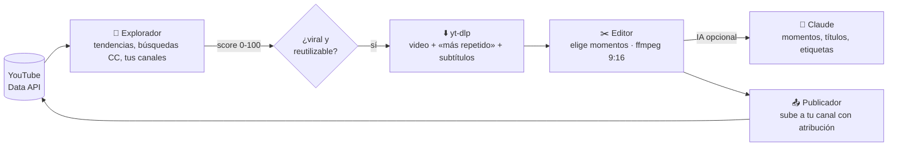
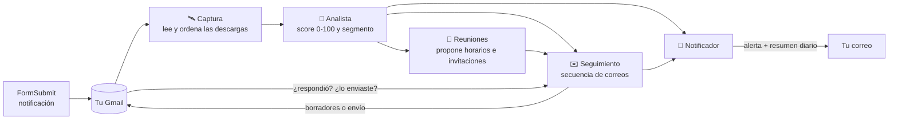

# Copahue · herramientas de finanzas

| App | Para qué sirve | Cómo se ejecuta |
|---|---|---|
| `tablero_ebook.py` | **Tablero con agentes** que analizan las descargas del ebook, te avisan por correo, hacen seguimiento y generan reuniones con potenciales clientes | `streamlit run tablero_ebook.py` |
| `app.py` | Generador de reportes Forpay (cuotas por empresa a Excel) | `streamlit run app.py` |
| `grok.py` | Chat con tus documentos PDF (Groq + Gemini) | `streamlit run grok.py` |
| `run_shorts.py` | **Agente de YouTube Shorts**: encuentra los videos más virales, elige los mejores momentos, los recorta en vertical y los sube a tu canal | `python run_shorts.py` |

---

## 🎬 Agente de YouTube Shorts

Tres agentes trabajan en cadena cada vez que ejecutas `python run_shorts.py`:



| Agente | Qué hace |
|---|---|
| **Explorador** | Consulta las **tendencias** de tus regiones, busca los videos **Creative Commons** más vistos de la semana y, si los configuras, tus **temas** y **canales**. Puntúa cada video (vistas por hora, interacción, recencia, duración aprovechable) y selecciona los que superan el umbral. Nunca repite un video. |
| **Editor** | Descarga el video con `yt-dlp`, lee el mapa de **«más repetido»** que YouTube dibuja en la barra de progreso y los subtítulos. Elige los momentos (con Claude si hay API key; si no, por el heatmap, la energía del audio o ventanas repartidas) y genera Shorts verticales 1080×1920 con `ffmpeg`: fondo difuminado o recorte al centro, rótulo con el título y subtítulos quemados. |
| **Publicador** | Sube cada corte a **tu canal** con título, descripción con **atribución al autor y enlace al original**, etiquetas y `#Shorts`. Respeta el máximo diario de subidas, la cuota de la API y la privacidad que elijas (por defecto `private`, para que revises en YouTube Studio antes de publicar). Puede dejar las publicaciones programadas cada N horas. |

### ⚠️ Antes de empezar: derechos de autor

Recortar y volver a subir videos ajenos sin permiso **infringe los derechos de autor y las Condiciones del
servicio de YouTube**: lo normal es recibir reclamos de Content ID, perder la monetización o acumular strikes.
Por eso el agente, por defecto, **solo reutiliza videos con licencia Creative Commons (CC BY)**, que YouTube
permite reutilizar con atribución (la descripción la incluye automáticamente), y además puede trabajar con
**tus propios canales** (`SHORTS_CANALES`), donde el permiso es tuyo. `SHORTS_LICENCIA=cualquiera` quita ese
filtro bajo tu responsabilidad.

### Puesta en marcha (20 minutos)

```bash
pip install -r requirements.txt     # y ffmpeg: https://ffmpeg.org/download.html (en Mac: brew install ffmpeg)
cp .env.example .env                # revisa la sección "Agente de YouTube Shorts"
python run_shorts.py auth           # autoriza tu cuenta de YouTube (abre el navegador una sola vez)
python run_shorts.py explorar       # mira qué está viral y qué seleccionaría
python run_shorts.py                # ciclo completo: explorar → cortar → subir (privados)
```

1. En [Google Cloud](https://console.cloud.google.com/) crea un proyecto y habilita **YouTube Data API v3**.
2. En *APIs y servicios → Credenciales* crea una **Clave de API** (pégala en `YOUTUBE_API_KEY`) y un
   **ID de cliente OAuth** de tipo *Aplicación de escritorio*; descarga el JSON como `data/youtube_client_secret.json`.
3. En *Pantalla de consentimiento OAuth* agrega tu correo como usuario de prueba. Si la app queda «En pruebas»,
   el token caduca cada 7 días (vuelve a correr `auth`); pásala a «En producción» para que no caduque.
4. `python run_shorts.py auth` guarda el token en `data/youtube_token.json` (ignorado por git). Para correr el agente
   en un servidor o entorno en la nube sin copiar archivos, pega el contenido de ese JSON en la variable
   `YOUTUBE_TOKEN_JSON` (y el del cliente OAuth en `YOUTUBE_CLIENT_SECRET_JSON`).

> **Límites de Google que conviene conocer.** La cuota gratuita es de 10 000 unidades/día y cada subida cuesta
> 1 600 (máximo 6 Shorts al día; el agente lleva la cuenta y se detiene solo). Además, los videos subidos por la
> API desde un proyecto que no ha pasado la [auditoría de cumplimiento](https://support.google.com/youtube/contact/yt_api_form)
> pueden quedar **bloqueados en privado**. Si te pasa, deja `SHORTS_PRIVACIDAD=private`, revisa los cortes en
> `data/shorts/<video>/corte_01.mp4` y publícalos desde YouTube Studio mientras solicitas la auditoría.

### Comandos

```bash
python run_shorts.py                          # un ciclo completo
python run_shorts.py --loop 180               # un ciclo cada 3 horas (deja tu PC o servidor trabajando)
python run_shorts.py explorar                 # solo explorar y mostrar el ranking
python run_shorts.py cortar --video <ID|URL>  # recortar un video que elijas tú (sin filtro de score)
python run_shorts.py subir --simular          # mostrar qué subiría, sin subir
python run_shorts.py subir --privacidad public
python run_shorts.py estado                   # resumen, ranking y bitácora
python run_shorts.py --sin-ia                 # no usar Claude aunque haya API key
```

### Qué se puede ajustar (`.env`)

| Variable | Para qué |
|---|---|
| `SHORTS_REGIONES`, `SHORTS_IDIOMAS` | Dónde mirar las tendencias y en qué idioma deben estar los videos |
| `SHORTS_TEMAS` | Palabras clave de tu nicho (cada búsqueda cuesta 100 unidades de cuota) |
| `SHORTS_CANALES` | Tus canales (IDs `UC…` o `@handles`): se reutilizan sin filtrar la licencia |
| `SHORTS_UMBRAL_VIRAL`, `SHORTS_VIDEOS_POR_CICLO` | Qué tan viral debe ser un video y cuántos se recortan por ciclo |
| `SHORTS_CORTES_POR_VIDEO`, `SHORTS_CORTE_DURACION`, `SHORTS_CORTE_MIN/MAX` | Cuántos cortes por video y cuánto duran (hasta 180 s) |
| `SHORTS_ESTILO`, `SHORTS_SUBTITULOS`, `SHORTS_ROTULO` | `difuminado` o `recorte`; subtítulos y rótulo quemados |
| `SHORTS_PRIVACIDAD`, `SHORTS_MAX_SUBIDAS_DIA`, `SHORTS_PROGRAMAR_CADA_HORAS` | Cómo y cuánto se publica |
| `SHORTS_FIRMA`, `SHORTS_ETIQUETAS` | Texto final de cada descripción y etiquetas fijas |
| `SHORTS_COOKIES` | Cookies de yt-dlp si YouTube pide «confirma que no eres un robot» |

### ¿Cómo se calcula el score?

| Factor | Puntos |
|---|---|
| Vistas por hora desde la publicación (`12·log10`) | hasta 60 |
| Interacción: (likes + 3·comentarios) / vistas | hasta 25 |
| Publicado hace menos de 2 días / esta semana | +10 / +5 |
| Dura entre 3 y 25 minutos (hay material para recortar) | +5 |

Se descartan transmisiones en vivo, videos fuera de `SHORTS_DURACION_MIN/MAX`, categorías excluidas
(Música por defecto), otros idiomas y, salvo en tus canales, los que no sean Creative Commons.

### Que trabaje solo

- **Tu PC o un servidor**: `python run_shorts.py --loop 360` (cada 6 horas). Es la opción recomendada: la
  descarga desde tu IP residencial no suele tener problemas.
- **GitHub Actions**: el flujo `.github/workflows/agentes-shorts.yml` corre cada 6 horas. Crea los secrets
  `YOUTUBE_API_KEY`, `YOUTUBE_CLIENT_SECRET_JSON`, `YOUTUBE_TOKEN_JSON` (contenido de los JSON) y la variable
  `SHORTS_ACTIVOS=true`. YouTube a veces bloquea las descargas desde servidores («Sign in to confirm you're not
  a bot»); en ese caso agrega el secret `SHORTS_COOKIES_TXT` con tus cookies exportadas o usa tu PC.

### IA opcional (Claude)

Con `ANTHROPIC_API_KEY`, el editor le pasa a Claude la transcripción y las zonas más repetidas, y Claude
elige los momentos con gancho (frases completas, inicio y final limpios) y escribe el título, la descripción y
las etiquetas de cada Short. Usa `claude-opus-5-5` con esfuerzo medio y respaldo automático del servidor
(`fallbacks: "default"`). Sin API key todo funciona igual con el heatmap de YouTube, el audio y plantillas.

### Pruebas

```bash
pytest -q tests/test_shorts.py
```

Estructura:

```
agentes_shorts/
  config.py        configuración desde .env
  db.py            SQLite: videos, cortes, cuota de la API, bitácora
  youtube_api.py   Data API v3: tendencias, búsquedas, canales, subida (OAuth) y control de cuota
  explorador.py    agente explorador (fuentes, score, filtros, selección)
  descarga.py      yt-dlp: video, heatmap «más repetido», subtítulos json3
  editor.py        agente editor (momentos por IA/heatmap/audio, render ffmpeg 9:16, subtítulos, rótulo)
  publicador.py    agente publicador (metadatos con atribución, límites, programación)
  llm.py           IA opcional con Claude
  orquestador.py   ciclo completo
run_shorts.py      ejecución por terminal / cron / GitHub Actions
```

---

## 📘 Tablero de agentes del ebook

Cada vez que alguien descarga el ebook desde tu sitio, FormSubmit te envía a Gmail un correo
**«Nueva descarga del ebook — Hyperion»** con nombre, correo, teléfono, cargo, empresa y motivo de descarga.
Los agentes leen esos correos y hacen el trabajo comercial por ti:



| Agente | Qué hace |
|---|---|
| **Captura** | Lee en Gmail las notificaciones de FormSubmit (o un CSV/Excel), evita duplicados y detecta descargas repetidas. |
| **Analista** | Puntúa cada lead (correo corporativo, cargo, empresa, motivo, país, teléfono, descargas repetidas, si respondió) y lo clasifica en 🔥 Caliente, 🌤️ Tibio o ❄️ Frío. Escribe una lectura comercial y cómo abordarlo. Resume tendencias. |
| **Seguimiento** | Arma una secuencia de 4 correos según el segmento (bienvenida → contenido de valor → invitación → último contacto). Los deja como **borradores en tu Gmail**, los envía solo o espera tu aprobación. Se detiene apenas el lead responde. |
| **Reuniones** | A los calientes y a quienes respondieron les propone 3 horarios hábiles. Genera el evento de Google Calendar con el lead como invitado, el archivo `.ics`, el link de WhatsApp y exporta los contactos a tu CRM (CSV compatible con HubSpot). |
| **Notificador** | Te envía una **alerta inmediata** cuando aparece un lead caliente o alguien te responde (con botones para responder, escribir por WhatsApp o agendar) y un **resumen diario** con las cifras del día. |

### Puesta en marcha (10 minutos)

```bash
pip install -r requirements.txt
cp .env.example .env          # completa GMAIL_USER y GMAIL_APP_PASSWORD
streamlit run tablero_ebook.py
```

1. **Contraseña de aplicación de Gmail**: activa la verificación en 2 pasos y crea una en
   <https://myaccount.google.com/apppasswords>. Pégala en `GMAIL_APP_PASSWORD`. (IMAP viene activo por defecto en Gmail.)
2. Abre el tablero y presiona **▶️ Ejecutar agentes ahora**: leerá las descargas de los últimos 120 días.
3. ¿Quieres verlo antes de conectar Gmail? En la barra lateral, **🧪 Datos de demostración → Cargar demo**
   (leads ficticios con dominios `.example`, que nunca reciben correos).

Personaliza en `.env` tu firma, el nombre del ebook, la oferta de reunión y, si tienes Calendly o
agenda de citas de Google, `LINK_AGENDA` (los correos usarán ese link en vez de proponer horarios).

### Modos de seguimiento

| Modo | Qué pasa con cada correo a un lead |
|---|---|
| `borradores` *(recomendado)* | Queda listo en **Borradores** de tu Gmail. Tú lo revisas y lo envías; el agente detecta que lo enviaste y sigue con el próximo paso. |
| `automatico` | Se envía solo, con un máximo de `SEGUIMIENTO_MAX_DIA` correos al día (primero los más calientes). |
| `manual` | Espera tu aprobación en la pestaña **✉️ Seguimiento** del tablero. |

Puedes cambiar el modo en la barra lateral del tablero. Los leads que descargaron hace más de 3 días y
nunca contactaste reciben un correo de **reactivación** (en vez de la bienvenida); los de más de 60 días quedan
para gestión manual, para no escribir en masa a una base antigua.

### Que trabajen solos las 24 horas

Elige una opción (no las dos con el mismo Gmail, para no duplicar borradores):

- **Tu PC o un servidor**: `python run_agentes.py --loop 15` revisa Gmail cada 15 minutos.
  El tablero (`streamlit run tablero_ebook.py`) lee la misma base de datos.
- **GitHub Actions** (gratis, sin PC encendido): el flujo `.github/workflows/agentes-ebook.yml` corre cada 30 minutos.
  En *Settings → Secrets and variables → Actions* crea los secrets `GMAIL_USER`, `GMAIL_APP_PASSWORD`
  (y opcionalmente `NOTIFY_EMAIL`, `ANTHROPIC_API_KEY`) y la variable `AGENTES_ACTIVOS=true`.
  Recibirás las alertas y el resumen por correo, y los borradores aparecerán en tu Gmail. En este modo
  el tablero es para consultar: usa allí el modo `manual` y gestiona los correos desde Gmail.

Comandos útiles:

```bash
python run_agentes.py              # un ciclo
python run_agentes.py --resumen    # fuerza el resumen diario
python run_agentes.py --sin-notificar
python run_agentes.py --demo       # carga datos ficticios
```

### IA opcional (Claude)

Con `ANTHROPIC_API_KEY`, el analista escribe una lectura más fina de los leads calientes y tibios, y
el agente de seguimiento personaliza cada correo (sin inventar datos y conservando horarios y links).
Usa el modelo `claude-opus-5-5` con esfuerzo bajo y respaldo automático del servidor (`fallbacks: "default"`)
si una solicitud es rechazada. Sin API key todo funciona igual con reglas y plantillas.

### ¿Cómo se calcula el score?

| Factor | Puntos |
|---|---|
| Correo corporativo (no Gmail/Hotmail/Outlook…) | +20 |
| Cargo: decisor (gerente, CFO, socio, fundador, dueño…) / jefatura / especialista / otro | +30 / +20 / +10 / +5 |
| Informó su empresa (independiente: +5) | +10 |
| Motivo: necesidad en su empresa / consultor-asesor / aprendizaje / otro | +25 / +10 / +3 / +5 |
| Dejó teléfono | +5 |
| País en `MERCADO_OBJETIVO` (por prefijo telefónico o dominio) | +10 |
| Descargó más de una vez | +10 |
| Respondió un correo | +25 |
| Descarga en los últimos 3 días | +5 |

🔥 Caliente ≥ `UMBRAL_CALIENTE` (70) · 🌤️ Tibio ≥ `UMBRAL_TIBIO` (40) · ❄️ Frío el resto.
Las reglas están en `agentes_ebook/analista.py` y las plantillas de correo en `agentes_ebook/plantillas.py`.

### Privacidad y seguridad

- Los datos de tus leads se guardan solo en `data/tablero_ebook.db` (ignorado por git) y, si usas Actions, en su caché privada.
- Las credenciales van en `.env` o en los Secrets de Streamlit/GitHub, nunca en el código.
- Los agentes leen Gmail en modo solo lectura (no marcan correos como leídos) y solo escriben borradores o
  envían correos según el modo que elijas.

### Pruebas

```bash
pip install pytest
pytest -q
```

Estructura:

```
agentes_ebook/
  config.py        configuración desde .env / secrets
  db.py            base SQLite: leads, descargas, seguimientos, reuniones, bitácora
  gmail.py         IMAP/SMTP: lee FormSubmit, detecta respuestas, crea borradores, envía
  captura.py       agente de captura (Gmail, CSV, demo)
  analista.py      agente analista (score, segmento, hallazgos)
  plantillas.py    correos, cadencias, links de WhatsApp y mailto
  seguimiento.py   agente de seguimiento
  reuniones.py     agente de reuniones (horarios, Google Calendar, .ics, CRM)
  notificador.py   alertas y resumen diario por correo
  llm.py           IA opcional con Claude
  orquestador.py   ciclo completo de los agentes
tablero_ebook.py   tablero Streamlit
run_agentes.py     ejecución por terminal / cron / GitHub Actions
```
