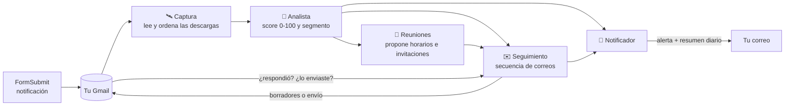

# Copahue · herramientas de finanzas

| App | Para qué sirve | Cómo se ejecuta |
|---|---|---|
| `tablero_ebook.py` | **Tablero con agentes** que analizan las descargas del ebook, te avisan por correo, hacen seguimiento y generan reuniones con potenciales clientes | `streamlit run tablero_ebook.py` |
| `gestion_clientes.py` | **Plataforma de gestión de clientes para estudios contables**: cartera de clientes, vencimientos tributarios y laborales, honorarios y cobranza | `streamlit run gestion_clientes.py` |
| `app.py` | Generador de reportes Forpay (cuotas por empresa a Excel) | `streamlit run app.py` |
| `grok.py` | Chat con tus documentos PDF (Groq + Gemini) | `streamlit run grok.py` |

---

## 🗂️ Gestión de clientes para estudios contables

Una sola pantalla para que el estudio sepa, cada mañana, **qué vence, qué falta pedirle a cada cliente y quién debe honorarios**.
Pensada para estudios contables chilenos (RUT, F29, Previred, Operación Renta, honorarios en pesos o UF).

```bash
pip install -r requirements.txt
streamlit run gestion_clientes.py
```

¿Quieres verla funcionando antes de cargar tus datos? En la barra lateral, **🧪 Datos de demostración → Cargar demo**
(un estudio ficticio con RUT y correos inventados).

| Pestaña | Qué resuelve |
|---|---|
| **📊 Panel** | Vencimientos atrasados y de los próximos 14 días, carga de trabajo por responsable, honorarios por cobrar según antigüedad y emitido vs. cobrado por mes. Se puede filtrar por persona del equipo. |
| **👥 Clientes** | Cartera con RUT validado (dígito verificador), régimen tributario, servicios contratados, responsable y honorario. Cada cliente tiene su ficha con vencimientos, cuenta corriente de honorarios, bitácora y datos. |
| **📅 Vencimientos** | Genera con un clic las obligaciones del mes (o del año) para todos los clientes activos según sus servicios. El estado, la fecha, el responsable y las notas se editan directo en la tabla. También admite tareas puntuales (requerimientos del SII, trámites). |
| **💰 Honorarios** | Emite los cobros del mes (convierte los pactados en UF), registra pagos totales o abonos, muestra la mora por tramos y redacta el recordatorio de pago para enviarlo por correo o WhatsApp. |
| **🗒️ Bitácora** | Llamadas, correos, reuniones y acuerdos con cada cliente, firmados por quien los anota. |
| **⚙️ Configuración** | Equipo, valor de la UF, calendario de vencimientos, importación de clientes desde CSV/Excel y exportación completa a Excel. |

### Cómo empezar con tus clientes

1. En **⚙️ Configuración** anota a tu **equipo** y el **valor de la UF** (si cobras honorarios en UF).
2. Carga tus clientes: uno a uno en **👥 Clientes → ➕ Nuevo cliente**, o todos juntos con **Importar clientes**
   (descarga ahí la planilla de ejemplo). Importar dos veces no duplica ni sobrescribe.
3. Marca en cada cliente sus **servicios contratados**: de ahí salen sus vencimientos.
4. Cada mes: **📅 Vencimientos → Generar** y **💰 Honorarios → Emitir**. Ambos se pueden repetir sin riesgo.

### Calendario de vencimientos

| Obligación | Cuándo vence (referencia) | Se genera si el cliente tiene |
|---|---|---|
| F29 · IVA, PPM y retenciones | Día 20 del mes siguiente (12 si no declara por internet con documentos electrónicos) | IVA mensual (F29) |
| Cotizaciones previsionales (Previred) | Día 13 del mes siguiente (10 con planilla presencial) | Remuneraciones |
| Libro de Remuneraciones Electrónico | Día 15 del mes siguiente | Remuneraciones |
| DJ 1887, DJ 1879 y DJ de rentas del régimen | Marzo del año siguiente | Declaraciones juradas |
| F22 · Renta anual | 30 de abril del año siguiente | Renta anual (F22) |
| Patente municipal | 31 de julio y 31 de enero | Patente municipal |

> **Las fechas son referenciales.** El SII, la Dirección del Trabajo y Previred publican sus calendarios cada año
> (las declaraciones juradas cambian con frecuencia). Ajusta el día y el mes en **⚙️ Configuración → Calendario de
> vencimientos**, o edita la fecha de un vencimiento puntual en su tabla.

Si la fecha cae en sábado, domingo o feriado nacional, se corre al día hábil siguiente. El Día de los Pueblos Indígenas,
las elecciones y los feriados regionales no vienen incluidos: agrégalos en `ESTUDIO_FERIADOS_EXTRA`. Mientras no lo
hagas, un vencimiento que caiga en uno de esos días se muestra en su fecha original, es decir, antes de la real.

### Configuración (`.env`)

| Variable | Para qué |
|---|---|
| `ESTUDIO_NOMBRE`, `ESTUDIO_FIRMA` | Nombre del estudio y firma de los mensajes a clientes |
| `ESTUDIO_CLAVE` | Clave de acceso a la plataforma. **Defínela si la app queda accesible desde internet.** |
| `ESTUDIO_EQUIPO` | Equipo inicial, separado por comas (después se edita en la app) |
| `ESTUDIO_VALOR_UF` | Valor inicial de la UF (después se actualiza en la app) |
| `ESTUDIO_HONORARIOS_DIA_VENCE` | Día del mes siguiente en que vencen los honorarios (por defecto, 5) |
| `ESTUDIO_DATOS_PAGO` | Datos de transferencia que se agregan a los recordatorios de pago |
| `ESTUDIO_DIAS_ALERTA` | Días de anticipación con que un vencimiento pasa a 🟡 (por defecto, 7) |
| `ESTUDIO_FERIADOS_EXTRA` | Feriados adicionales `AAAA-MM-DD`, separados por comas |
| `ESTUDIO_DB` | Archivo de datos (por defecto, `data/estudio.db`) |

### Datos y seguridad

- Todo se guarda en `data/estudio.db` (SQLite, ignorado por git). Respáldalo, o usa **⬇️ Exportar todo a Excel**.
- La plataforma **no guarda claves tributarias ni de Previred** y no se conecta al SII: no las anotes en las notas.
- `ESTUDIO_CLAVE` es una clave única compartida por el equipo, suficiente para una red interna. Para publicarla en
  internet, ponla detrás del inicio de sesión de tu proveedor (por ejemplo, el control de acceso de Streamlit Cloud).
- Los recordatorios se abren en tu correo o en WhatsApp para que tú los envíes: la plataforma no manda nada sola.

Si usas el tablero del ebook, **⚙️ Configuración → Traer clientes ganados** crea como prospectos los leads que
marcaste en la etapa «Cliente».

```
estudio/
  config.py        configuración desde .env / secrets
  rut.py           validación y formato de RUT
  db.py            base SQLite: clientes, vencimientos, cobros, pagos, bitácora
  calendario.py    catálogo de obligaciones, feriados, generación de vencimientos, semáforo
  cobranza.py      emisión de honorarios, pagos, mora por tramos, mensajes a clientes
  intercambio.py   importar clientes (CSV/Excel), exportar a Excel, traer leads del ebook
  demo.py          estudio ficticio de demostración
gestion_clientes.py  plataforma Streamlit
```

---

## 📘 Tablero de agentes del ebook

Cada vez que alguien descarga el ebook desde tu sitio, FormSubmit te envía a Gmail un correo
**«Nueva descarga del ebook — Hyperion»** con nombre, correo, teléfono, cargo, empresa y motivo de descarga.
Los agentes leen esos correos y hacen el trabajo comercial por ti:



| Agente | Qué hace |
|---|---|
| **Captura** | Lee en Gmail las notificaciones de FormSubmit (o un CSV/Excel), evita duplicados y detecta descargas repetidas. |
| **Analista** | Puntúa cada lead (correo corporativo, cargo, empresa, motivo, país, teléfono, descargas repetidas, si respondió) y lo clasifica en 🔥 Caliente, 🌤️ Tibio o ❄️ Frío. Escribe una lectura comercial y cómo abordarlo. Resume tendencias. |
| **Seguimiento** | Arma una secuencia de 4 correos según el segmento (bienvenida → contenido de valor → invitación → último contacto). Los deja como **borradores en tu Gmail**, los envía solo o espera tu aprobación. Se detiene apenas el lead responde. |
| **Reuniones** | A los calientes y a quienes respondieron les propone 3 horarios hábiles. Genera el evento de Google Calendar con el lead como invitado, el archivo `.ics`, el link de WhatsApp y exporta los contactos a tu CRM (CSV compatible con HubSpot). |
| **Notificador** | Te envía una **alerta inmediata** cuando aparece un lead caliente o alguien te responde (con botones para responder, escribir por WhatsApp o agendar) y un **resumen diario** con las cifras del día. |

### Puesta en marcha (10 minutos)

```bash
pip install -r requirements.txt
cp .env.example .env          # completa GMAIL_USER y GMAIL_APP_PASSWORD
streamlit run tablero_ebook.py
```

1. **Contraseña de aplicación de Gmail**: activa la verificación en 2 pasos y crea una en
   <https://myaccount.google.com/apppasswords>. Pégala en `GMAIL_APP_PASSWORD`. (IMAP viene activo por defecto en Gmail.)
2. Abre el tablero y presiona **▶️ Ejecutar agentes ahora**: leerá las descargas de los últimos 120 días.
3. ¿Quieres verlo antes de conectar Gmail? En la barra lateral, **🧪 Datos de demostración → Cargar demo**
   (leads ficticios con dominios `.example`, que nunca reciben correos).

Personaliza en `.env` tu firma, el nombre del ebook, la oferta de reunión y, si tienes Calendly o
agenda de citas de Google, `LINK_AGENDA` (los correos usarán ese link en vez de proponer horarios).

### Modos de seguimiento

| Modo | Qué pasa con cada correo a un lead |
|---|---|
| `borradores` *(recomendado)* | Queda listo en **Borradores** de tu Gmail. Tú lo revisas y lo envías; el agente detecta que lo enviaste y sigue con el próximo paso. |
| `automatico` | Se envía solo, con un máximo de `SEGUIMIENTO_MAX_DIA` correos al día (primero los más calientes). |
| `manual` | Espera tu aprobación en la pestaña **✉️ Seguimiento** del tablero. |

Puedes cambiar el modo en la barra lateral del tablero. Los leads que descargaron hace más de 3 días y
nunca contactaste reciben un correo de **reactivación** (en vez de la bienvenida); los de más de 60 días quedan
para gestión manual, para no escribir en masa a una base antigua.

### Que trabajen solos las 24 horas

Elige una opción (no las dos con el mismo Gmail, para no duplicar borradores):

- **Tu PC o un servidor**: `python run_agentes.py --loop 15` revisa Gmail cada 15 minutos.
  El tablero (`streamlit run tablero_ebook.py`) lee la misma base de datos.
- **GitHub Actions** (gratis, sin PC encendido): el flujo `.github/workflows/agentes-ebook.yml` corre cada 30 minutos.
  En *Settings → Secrets and variables → Actions* crea los secrets `GMAIL_USER`, `GMAIL_APP_PASSWORD`
  (y opcionalmente `NOTIFY_EMAIL`, `ANTHROPIC_API_KEY`) y la variable `AGENTES_ACTIVOS=true`.
  Recibirás las alertas y el resumen por correo, y los borradores aparecerán en tu Gmail. En este modo
  el tablero es para consultar: usa allí el modo `manual` y gestiona los correos desde Gmail.

Comandos útiles:

```bash
python run_agentes.py              # un ciclo
python run_agentes.py --resumen    # fuerza el resumen diario
python run_agentes.py --sin-notificar
python run_agentes.py --demo       # carga datos ficticios
```

### IA opcional (Claude)

Con `ANTHROPIC_API_KEY`, el analista escribe una lectura más fina de los leads calientes y tibios, y
el agente de seguimiento personaliza cada correo (sin inventar datos y conservando horarios y links).
Usa el modelo `claude-opus-5-5` con esfuerzo bajo y respaldo automático del servidor (`fallbacks: "default"`)
si una solicitud es rechazada. Sin API key todo funciona igual con reglas y plantillas.

### ¿Cómo se calcula el score?

| Factor | Puntos |
|---|---|
| Correo corporativo (no Gmail/Hotmail/Outlook…) | +20 |
| Cargo: decisor (gerente, CFO, socio, fundador, dueño…) / jefatura / especialista / otro | +30 / +20 / +10 / +5 |
| Informó su empresa (independiente: +5) | +10 |
| Motivo: necesidad en su empresa / consultor-asesor / aprendizaje / otro | +25 / +10 / +3 / +5 |
| Dejó teléfono | +5 |
| País en `MERCADO_OBJETIVO` (por prefijo telefónico o dominio) | +10 |
| Descargó más de una vez | +10 |
| Respondió un correo | +25 |
| Descarga en los últimos 3 días | +5 |

🔥 Caliente ≥ `UMBRAL_CALIENTE` (70) · 🌤️ Tibio ≥ `UMBRAL_TIBIO` (40) · ❄️ Frío el resto.
Las reglas están en `agentes_ebook/analista.py` y las plantillas de correo en `agentes_ebook/plantillas.py`.

### Privacidad y seguridad

- Los datos de tus leads se guardan solo en `data/tablero_ebook.db` (ignorado por git) y, si usas Actions, en su caché privada.
- Las credenciales van en `.env` o en los Secrets de Streamlit/GitHub, nunca en el código.
- Los agentes leen Gmail en modo solo lectura (no marcan correos como leídos) y solo escriben borradores o
  envían correos según el modo que elijas.

### Pruebas

```bash
pip install pytest
pytest -q
```

Estructura:

```
agentes_ebook/
  config.py        configuración desde .env / secrets
  db.py            base SQLite: leads, descargas, seguimientos, reuniones, bitácora
  gmail.py         IMAP/SMTP: lee FormSubmit, detecta respuestas, crea borradores, envía
  captura.py       agente de captura (Gmail, CSV, demo)
  analista.py      agente analista (score, segmento, hallazgos)
  plantillas.py    correos, cadencias, links de WhatsApp y mailto
  seguimiento.py   agente de seguimiento
  reuniones.py     agente de reuniones (horarios, Google Calendar, .ics, CRM)
  notificador.py   alertas y resumen diario por correo
  llm.py           IA opcional con Claude
  orquestador.py   ciclo completo de los agentes
tablero_ebook.py   tablero Streamlit
run_agentes.py     ejecución por terminal / cron / GitHub Actions
```
