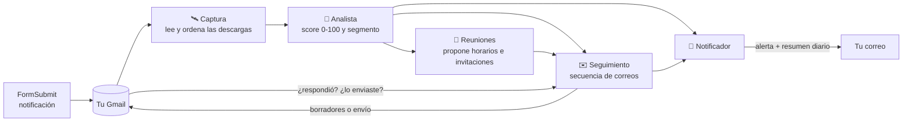
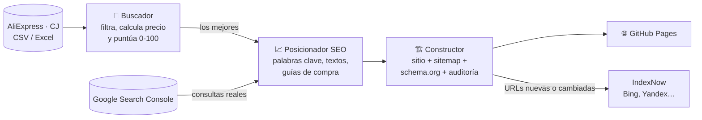

# Copahue · herramientas de finanzas y comercio

| App | Para qué sirve | Cómo se ejecuta |
|---|---|---|
| `run_tienda.py` + `tablero_tienda.py` | **Tienda tipo marketplace con agentes**: un agente busca los mejores productos para vender (dropshipping/afiliados) y otro posiciona la tienda en Google, todo en automático | `python run_tienda.py --demo --servir` |
| `tablero_ebook.py` | **Tablero con agentes** que analizan las descargas del ebook, te avisan por correo, hacen seguimiento y generan reuniones con potenciales clientes | `streamlit run tablero_ebook.py` |
| `app.py` | Generador de reportes Forpay (cuotas por empresa a Excel) | `streamlit run app.py` |
| `grok.py` | Chat con tus documentos PDF (Groq + Gemini) | `streamlit run grok.py` |

---

## 📘 Tablero de agentes del ebook

Cada vez que alguien descarga el ebook desde tu sitio, FormSubmit te envía a Gmail un correo
**«Nueva descarga del ebook — Hyperion»** con nombre, correo, teléfono, cargo, empresa y motivo de descarga.
Los agentes leen esos correos y hacen el trabajo comercial por ti:



| Agente | Qué hace |
|---|---|
| **Captura** | Lee en Gmail las notificaciones de FormSubmit (o un CSV/Excel), evita duplicados y detecta descargas repetidas. |
| **Analista** | Puntúa cada lead (correo corporativo, cargo, empresa, motivo, país, teléfono, descargas repetidas, si respondió) y lo clasifica en 🔥 Caliente, 🌤️ Tibio o ❄️ Frío. Escribe una lectura comercial y cómo abordarlo. Resume tendencias. |
| **Seguimiento** | Arma una secuencia de 4 correos según el segmento (bienvenida → contenido de valor → invitación → último contacto). Los deja como **borradores en tu Gmail**, los envía solo o espera tu aprobación. Se detiene apenas el lead responde. |
| **Reuniones** | A los calientes y a quienes respondieron les propone 3 horarios hábiles. Genera el evento de Google Calendar con el lead como invitado, el archivo `.ics`, el link de WhatsApp y exporta los contactos a tu CRM (CSV compatible con HubSpot). |
| **Notificador** | Te envía una **alerta inmediata** cuando aparece un lead caliente o alguien te responde (con botones para responder, escribir por WhatsApp o agendar) y un **resumen diario** con las cifras del día. |

### Puesta en marcha (10 minutos)

```bash
pip install -r requirements.txt
cp .env.example .env          # completa GMAIL_USER y GMAIL_APP_PASSWORD
streamlit run tablero_ebook.py
```

1. **Contraseña de aplicación de Gmail**: activa la verificación en 2 pasos y crea una en
   <https://myaccount.google.com/apppasswords>. Pégala en `GMAIL_APP_PASSWORD`. (IMAP viene activo por defecto en Gmail.)
2. Abre el tablero y presiona **▶️ Ejecutar agentes ahora**: leerá las descargas de los últimos 120 días.
3. ¿Quieres verlo antes de conectar Gmail? En la barra lateral, **🧪 Datos de demostración → Cargar demo**
   (leads ficticios con dominios `.example`, que nunca reciben correos).

Personaliza en `.env` tu firma, el nombre del ebook, la oferta de reunión y, si tienes Calendly o
agenda de citas de Google, `LINK_AGENDA` (los correos usarán ese link en vez de proponer horarios).

### Modos de seguimiento

| Modo | Qué pasa con cada correo a un lead |
|---|---|
| `borradores` *(recomendado)* | Queda listo en **Borradores** de tu Gmail. Tú lo revisas y lo envías; el agente detecta que lo enviaste y sigue con el próximo paso. |
| `automatico` | Se envía solo, con un máximo de `SEGUIMIENTO_MAX_DIA` correos al día (primero los más calientes). |
| `manual` | Espera tu aprobación en la pestaña **✉️ Seguimiento** del tablero. |

Puedes cambiar el modo en la barra lateral del tablero. Los leads que descargaron hace más de 3 días y
nunca contactaste reciben un correo de **reactivación** (en vez de la bienvenida); los de más de 60 días quedan
para gestión manual, para no escribir en masa a una base antigua.

### Que trabajen solos las 24 horas

Elige una opción (no las dos con el mismo Gmail, para no duplicar borradores):

- **Tu PC o un servidor**: `python run_agentes.py --loop 15` revisa Gmail cada 15 minutos.
  El tablero (`streamlit run tablero_ebook.py`) lee la misma base de datos.
- **GitHub Actions** (gratis, sin PC encendido): el flujo `.github/workflows/agentes-ebook.yml` corre cada 30 minutos.
  En *Settings → Secrets and variables → Actions* crea los secrets `GMAIL_USER`, `GMAIL_APP_PASSWORD`
  (y opcionalmente `NOTIFY_EMAIL`, `ANTHROPIC_API_KEY`) y la variable `AGENTES_ACTIVOS=true`.
  Recibirás las alertas y el resumen por correo, y los borradores aparecerán en tu Gmail. En este modo
  el tablero es para consultar: usa allí el modo `manual` y gestiona los correos desde Gmail.

Comandos útiles:

```bash
python run_agentes.py              # un ciclo
python run_agentes.py --resumen    # fuerza el resumen diario
python run_agentes.py --sin-notificar
python run_agentes.py --demo       # carga datos ficticios
```

### IA opcional (Claude)

Con `ANTHROPIC_API_KEY`, el analista escribe una lectura más fina de los leads calientes y tibios, y
el agente de seguimiento personaliza cada correo (sin inventar datos y conservando horarios y links).
Usa el modelo `claude-opus-5-5` con esfuerzo bajo y respaldo automático del servidor (`fallbacks: "default"`)
si una solicitud es rechazada. Sin API key todo funciona igual con reglas y plantillas.

### ¿Cómo se calcula el score?

| Factor | Puntos |
|---|---|
| Correo corporativo (no Gmail/Hotmail/Outlook…) | +20 |
| Cargo: decisor (gerente, CFO, socio, fundador, dueño…) / jefatura / especialista / otro | +30 / +20 / +10 / +5 |
| Informó su empresa (independiente: +5) | +10 |
| Motivo: necesidad en su empresa / consultor-asesor / aprendizaje / otro | +25 / +10 / +3 / +5 |
| Dejó teléfono | +5 |
| País en `MERCADO_OBJETIVO` (por prefijo telefónico o dominio) | +10 |
| Descargó más de una vez | +10 |
| Respondió un correo | +25 |
| Descarga en los últimos 3 días | +5 |

🔥 Caliente ≥ `UMBRAL_CALIENTE` (70) · 🌤️ Tibio ≥ `UMBRAL_TIBIO` (40) · ❄️ Frío el resto.
Las reglas están en `agentes_ebook/analista.py` y las plantillas de correo en `agentes_ebook/plantillas.py`.

### Privacidad y seguridad

- Los datos de tus leads se guardan solo en `data/tablero_ebook.db` (ignorado por git) y, si usas Actions, en su caché privada.
- Las credenciales van en `.env` o en los Secrets de Streamlit/GitHub, nunca en el código.
- Los agentes leen Gmail en modo solo lectura (no marcan correos como leídos) y solo escriben borradores o
  envían correos según el modo que elijas.

### Pruebas

```bash
pip install pytest
pytest -q
```

Estructura:

```
agentes_ebook/
  config.py        configuración desde .env / secrets
  db.py            base SQLite: leads, descargas, seguimientos, reuniones, bitácora
  gmail.py         IMAP/SMTP: lee FormSubmit, detecta respuestas, crea borradores, envía
  captura.py       agente de captura (Gmail, CSV, demo)
  analista.py      agente analista (score, segmento, hallazgos)
  plantillas.py    correos, cadencias, links de WhatsApp y mailto
  seguimiento.py   agente de seguimiento
  reuniones.py     agente de reuniones (horarios, Google Calendar, .ics, CRM)
  notificador.py   alertas y resumen diario por correo
  llm.py           IA opcional con Claude
  orquestador.py   ciclo completo de los agentes
tablero_ebook.py   tablero Streamlit
run_agentes.py     ejecución por terminal / cron / GitHub Actions
```

---

## 🛍️ Tienda tipo marketplace con agentes

Una tienda online estática (rápida, gratis en GitHub Pages y muy fácil de indexar) que dos agentes
mantienen solos todos los días:



| Agente | Qué hace |
|---|---|
| **Buscador** | Busca cada categoría en los proveedores (AliExpress API de afiliados, CJ Dropshipping o un CSV de Dropi/AutoDS/etc.). Descarta réplicas de marcas, productos restringidos en Chile (baterías de litio, vapes, drones, láseres…) y los sin fotos. Convierte a pesos con el **dólar observado del día**, calcula precio de venta, margen y ganancia por venta, y puntúa: demanda (30), margen o comisión (25), valoración (15), precio de compra impulsiva (15), rapidez de envío (10) y fotos (5). Publica los mejores, revisa a diario precio y disponibilidad de lo publicado y **pausa** lo que deja de existir o pierde margen. |
| **Posicionador** | Investiga qué escribe la gente en Google Chile (autocompletado) y elige la palabra clave de cada producto. Escribe título SEO, meta descripción, descripción, beneficios y preguntas frecuentes (con **Claude** si hay `ANTHROPIC_API_KEY`, sin inventar datos ni reseñas; si no, con plantillas basadas en datos). Crea textos de categoría y **guías «Los mejores … en Chile»**. Con Search Console conectado, **reescribe el título y la meta de las páginas que Google muestra pero nadie cliquea** (y espera 21 días para medir antes de volver a tocarlas). |
| **Constructor** | Genera portada, categorías, una página por producto, guías, buscador interno, páginas legales chilenas (retracto de 10 días, garantía legal), `sitemap.xml` con fechas reales de cambio, `robots.txt`, datos estructurados (`Product`, `Offer`, `BreadcrumbList`, `ItemList`), feed de **Google Merchant Center** (modo dropshipping) y una **auditoría SEO** de cada página. Las URLs nunca cambian: si un producto se retira, su página queda viva con alternativas. |

### Pruébala en 1 minuto (sin claves)

```bash
pip install -r requirements.txt
python run_tienda.py --demo --servir      # abre http://localhost:8000
streamlit run tablero_tienda.py           # tablero de control
python run_tienda.py --borrar-demo        # cuando conectes un proveedor real
```

La demo usa productos ficticios y publica el sitio con `noindex` hasta que la borres.

### Dos formas de ganar dinero (`TIENDA_MODO`)

| | `afiliado` *(por defecto)* | `dropshipping` |
|---|---|---|
| Cómo ganas | Comisión (≈3-9 %) cuando alguien compra en AliExpress desde tu enlace | Diferencia entre tu precio y el costo del proveedor (margen mínimo configurable, IVA y comisión de pago incluidos) |
| Qué haces tú | Nada: el cliente compra y recibe directo del proveedor | Recibes el pedido por correo (FormSubmit), el cliente paga con link de **Mercado Pago**, tú compras al proveedor con la dirección del cliente |
| Requisitos | Cuenta de afiliado de AliExpress | Inicio de actividades en el SII y boleta electrónica, atención de reclamos y devoluciones (Ley 19.496) |
| Automático | 100 % | Captación y cobro automáticos; la compra al proveedor es manual |

### Puesta en marcha en GitHub (gratis, corre sola cada día)

1. **Proveedor** (al menos uno):
   - **AliExpress**: crea tu cuenta en <https://portals.aliexpress.com> (te da el *Tracking ID*) y una app de
     afiliado en <https://openservice.aliexpress.com> (te da *App Key* y *App Secret*).
   - **CJ Dropshipping** (para modo dropshipping): *My CJ → Authorization → API*.
   - O importa un CSV/Excel de cualquier herramienta: `python run_tienda.py --importar productos.csv --nicho "Mascotas" --moneda CLP`
     (o desde el tablero). Se reconocen columnas como *nombre, precio, imagen, rating, ventas, link, link_afiliado*.
2. *Settings → Pages → Source:* **GitHub Actions**.
3. *Settings → Secrets and variables → Actions*:
   - Secrets: `ALIEXPRESS_APP_KEY`, `ALIEXPRESS_APP_SECRET`, `ALIEXPRESS_TRACKING_ID` (y/o `CJ_API_KEY`).
     Opcionales: `ANTHROPIC_API_KEY`, `INDEXNOW_CLAVE`, `GSC_CREDENCIALES`, `MERCADOPAGO_ACCESS_TOKEN`.
   - Variables: `TIENDA_ACTIVA=true` y, si quieres, `TIENDA_NOMBRE`, `TIENDA_NICHOS`, `TIENDA_MODO`, `TIENDA_CORREO`,
     `TIENDA_WHATSAPP`, `TIENDA_DOMINIO`, `GOOGLE_SITE_VERIFICATION`… (lista completa en `.env.example`).
4. Ejecuta el flujo **Tienda (agentes + sitio)** desde la pestaña *Actions* (luego corre solo cada mañana).
   Cada ciclo guarda la memoria de los agentes en `tienda_datos/` con un commit: así ves en el historial qué
   publicó, pausó o reescribió cada agente.
5. **Google**: agrega la tienda en [Search Console](https://search.google.com/search-console), verifica con
   `GOOGLE_SITE_VERIFICATION` y envía `sitemap.xml`. Para que el Posicionador aprenda de Google, crea una cuenta
   de servicio en Google Cloud, habilita la *Search Console API*, agrégala como usuario de tu propiedad y guarda
   su JSON en el secret `GSC_CREDENCIALES`.
6. **Bing / IndexNow**: define `INDEXNOW_CLAVE` (cualquier texto de 8 a 128 letras y números). Tras cada
   publicación se avisan solo las URLs nuevas o cambiadas.

### Cosas que conviene saber

- **Nada garantiza ventas.** El SEO de una tienda nueva suele tardar de 3 a 6 meses en traer visitas constantes;
  las guías de compra y el aprendizaje desde Search Console son lo que más acelera. Un dominio propio (`.cl`)
  ayuda a la confianza y al posicionamiento.
- Google penaliza el contenido masivo de baja calidad: por eso el agente limita los productos nuevos por ciclo,
  no inventa reseñas ni especificaciones y no publica guías con menos de 3 productos.
- Revisa las páginas legales (`agentes_tienda/plantillas/terminos.html` y `privacidad.html`) con un abogado
  antes de vender en modo dropshipping.
- Tus decisiones mandan: desde el tablero puedes publicar, pausar o descartar cualquier producto y el agente lo respeta.

### Estructura

```
agentes_tienda/
  config.py        configuración desde .env / secrets
  almacen.py       memoria en JSON (tienda_datos/), bitácora de decisiones
  fuentes/         aliexpress.py · cj.py · archivo.py (CSV/Excel) · demo.py
  divisas.py       dólar observado (mindicador.cl)
  buscador.py      agente Buscador: filtros, precio, margen, score, selección
  keywords.py      autocompletado de Google Chile
  llm.py           redacción con Claude (opcional)
  seo.py           agente Posicionador + auditoría SEO
  indexacion.py    IndexNow y Google Search Console
  pagos.py         links de pago de Mercado Pago (dropshipping)
  sitio.py         generador del sitio estático + schema.org
  plantillas/      HTML, CSS y JS de la tienda
  orquestador.py   ciclo completo
run_tienda.py      ejecución por terminal / GitHub Actions
tablero_tienda.py  tablero Streamlit
.github/workflows/tienda.yml
```
