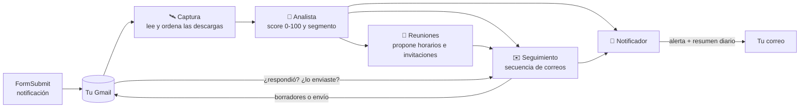

# Copahue · herramientas de finanzas

| App | Para qué sirve | Cómo se ejecuta |
|---|---|---|
| `copahue/` | **SaaS para estudios contables**: cartera de clientes, calendario tributario, documentos, cobranza y automatizaciones que dejan todo listo para aprobar | `python -m copahue` |
| `tablero_ebook.py` | **Tablero con agentes** que analizan las descargas del ebook, te avisan por correo, hacen seguimiento y generan reuniones con potenciales clientes | `streamlit run tablero_ebook.py` |
| `app.py` | Generador de reportes Forpay (cuotas por empresa a Excel) | `streamlit run app.py` |
| `grok.py` | Chat con tus documentos PDF (Groq + Gemini) | `streamlit run grok.py` |

---

## Copahue · gestión de clientes para estudios contables

Aplicación web multi-estudio (cada estudio ve solo sus datos) con diseño propio de inspiración Apple:
tipografía del sistema, un solo color de acento, modo claro y oscuro, y versión móvil con barra de pestañas.

```bash
pip install -r requirements.txt
python -m copahue            # http://localhost:8000
```

Entra con **«Explorar con un estudio de ejemplo»**: cada visitante recibe un estudio ficticio armado
alrededor de la fecha de hoy (16 clientes, declaraciones por vencer, documentos que faltan, facturas
atrasadas y cifras fuera de lo normal). Los correos de ejemplo usan dominios `.example` y nunca salen.

| Sección | Qué hace |
|---|---|
| **Hoy** | Resumen del día: lo que espera aprobación, agenda tributaria, clientes que requieren atención, tareas y actividad. |
| **Para revisar** | Bandeja al estilo de Mail con los correos y tareas que prepararon las automatizaciones. Editas el borrador y apruebas con `⌘↵`. |
| **Clientes** | Cartera con salud 0-100, próximo vencimiento, documentos y deuda. Ficha con ventas y compras de 12 meses, declaraciones, documentos, honorarios y actividad. |
| **Vencimientos** | Calendario mensual de F29, Previred, LRE y F22, con feriados chilenos y cambio de estado. |
| **Documentos** | Lo que cada cliente envió y lo que falta del último mes, con casillas al estilo de Recordatorios. |
| **Cobranza** | Honorarios vencidos, por vencer y cobrados; registro de pagos. |
| **Barra ⌘K** | Busca clientes o recibe pedidos: «pide los documentos que faltan», «prepara la cobranza». |

### Automatizaciones (los agentes)

Revisan la cartera cada `COPAHUE_INTERVALO_MIN` minutos (30 por defecto) y dejan **propuestas**. Cada una
puede **pedir aprobación** (por defecto) o **actuar sola**:

| Automatización | Qué propone |
|---|---|
| **Calendario tributario** | Genera las obligaciones según los servicios contratados (F29 día 20, Previred día 13, LRE día 15, F22 30 de abril, corridos al siguiente día hábil) y asigna las que vencen en 3 días hábiles. |
| **Solicitud de documentos** | Pide cartolas, gastos y novedades de remuneraciones con la fecha del próximo vencimiento; recuerda cada 3 días si no llegan. |
| **Revisión de cifras** | Compara ventas, compras, IVA y remuneraciones con el promedio de 6 meses; redacta la consulta al cliente o propone revisión interna (remanente de crédito fiscal, alza de sueldos). |
| **Cobranza de honorarios** | Recordatorio amable (< 15 días), segundo aviso (15-44) y llamada del socio (≥ 45). |
| **Salud de la cartera** | Detecta clientes en riesgo, clientes con trabajadores sin servicio de remuneraciones y honorarios que no se ajustan hace más de un año. |
| **Informe mensual** | Cuando el mes quedó declarado, prepara el resumen para el cliente. |

Las propuestas no se repiten: si la situación se resuelve sola (el cliente envió todo), se retiran.
Para correr las automatizaciones desde cron en vez del servidor: `python -m copahue --automatizaciones`.

### Configuración

Todo va en `.env` (ver `.env.example`):

- **Correo saliente**: `SMTP_HOST`, `SMTP_USUARIO`, `SMTP_CLAVE`, `SMTP_REMITENTE`. Sin SMTP, lo aprobado queda registrado sin enviarse.
- **Redacción asistida (opcional)**: con `ANTHROPIC_API_KEY`, Claude (`claude-opus-5-5`, esfuerzo bajo y respaldo automático del servidor) pule los borradores conservando cifras, fechas y firma, y la barra ⌘K entiende pedidos abiertos usando herramientas que leen la cartera. Todo lo que propone pasa por **Para revisar**; nunca envía por su cuenta. Sin clave, funciona con plantillas y reglas.
- **Producción**: sirve detrás de HTTPS con `COPAHUE_COOKIE_SEGURA=1` y `python -m copahue --host 0.0.0.0`.

Seguridad: contraseñas con PBKDF2, sesiones en servidor con cookie `HttpOnly`, encabezado propio obligatorio en
toda mutación (protección CSRF) y todas las consultas filtradas por estudio. El calendario incluye feriados
2025-2027 en `copahue/calendario.py`; verifica cada año el calendario oficial del SII.

```
copahue/
  api.py            API (FastAPI) y servidor de la aplicación web
  calendario.py     días hábiles, feriados y reglas de F29, Previred, LRE y F22
  salud.py          puntaje de salud de cada cliente
  agentes/          las seis automatizaciones y la ejecución de propuestas aprobadas
  asistente.py      barra de instrucciones (reglas o Claude)
  llm.py            redacción asistida y herramientas para Claude
  demo.py           estudio de ejemplo
  web/              interfaz (HTML, CSS y JavaScript sin dependencias ni compilación)
tests/test_copahue.py
```

---

## 📘 Tablero de agentes del ebook

Cada vez que alguien descarga el ebook desde tu sitio, FormSubmit te envía a Gmail un correo
**«Nueva descarga del ebook — Hyperion»** con nombre, correo, teléfono, cargo, empresa y motivo de descarga.
Los agentes leen esos correos y hacen el trabajo comercial por ti:



| Agente | Qué hace |
|---|---|
| **Captura** | Lee en Gmail las notificaciones de FormSubmit (o un CSV/Excel), evita duplicados y detecta descargas repetidas. |
| **Analista** | Puntúa cada lead (correo corporativo, cargo, empresa, motivo, país, teléfono, descargas repetidas, si respondió) y lo clasifica en 🔥 Caliente, 🌤️ Tibio o ❄️ Frío. Escribe una lectura comercial y cómo abordarlo. Resume tendencias. |
| **Seguimiento** | Arma una secuencia de 4 correos según el segmento (bienvenida → contenido de valor → invitación → último contacto). Los deja como **borradores en tu Gmail**, los envía solo o espera tu aprobación. Se detiene apenas el lead responde. |
| **Reuniones** | A los calientes y a quienes respondieron les propone 3 horarios hábiles. Genera el evento de Google Calendar con el lead como invitado, el archivo `.ics`, el link de WhatsApp y exporta los contactos a tu CRM (CSV compatible con HubSpot). |
| **Notificador** | Te envía una **alerta inmediata** cuando aparece un lead caliente o alguien te responde (con botones para responder, escribir por WhatsApp o agendar) y un **resumen diario** con las cifras del día. |

### Puesta en marcha (10 minutos)

```bash
pip install -r requirements.txt
cp .env.example .env          # completa GMAIL_USER y GMAIL_APP_PASSWORD
streamlit run tablero_ebook.py
```

1. **Contraseña de aplicación de Gmail**: activa la verificación en 2 pasos y crea una en
   <https://myaccount.google.com/apppasswords>. Pégala en `GMAIL_APP_PASSWORD`. (IMAP viene activo por defecto en Gmail.)
2. Abre el tablero y presiona **▶️ Ejecutar agentes ahora**: leerá las descargas de los últimos 120 días.
3. ¿Quieres verlo antes de conectar Gmail? En la barra lateral, **🧪 Datos de demostración → Cargar demo**
   (leads ficticios con dominios `.example`, que nunca reciben correos).

Personaliza en `.env` tu firma, el nombre del ebook, la oferta de reunión y, si tienes Calendly o
agenda de citas de Google, `LINK_AGENDA` (los correos usarán ese link en vez de proponer horarios).

### Modos de seguimiento

| Modo | Qué pasa con cada correo a un lead |
|---|---|
| `borradores` *(recomendado)* | Queda listo en **Borradores** de tu Gmail. Tú lo revisas y lo envías; el agente detecta que lo enviaste y sigue con el próximo paso. |
| `automatico` | Se envía solo, con un máximo de `SEGUIMIENTO_MAX_DIA` correos al día (primero los más calientes). |
| `manual` | Espera tu aprobación en la pestaña **✉️ Seguimiento** del tablero. |

Puedes cambiar el modo en la barra lateral del tablero. Los leads que descargaron hace más de 3 días y
nunca contactaste reciben un correo de **reactivación** (en vez de la bienvenida); los de más de 60 días quedan
para gestión manual, para no escribir en masa a una base antigua.

### Que trabajen solos las 24 horas

Elige una opción (no las dos con el mismo Gmail, para no duplicar borradores):

- **Tu PC o un servidor**: `python run_agentes.py --loop 15` revisa Gmail cada 15 minutos.
  El tablero (`streamlit run tablero_ebook.py`) lee la misma base de datos.
- **GitHub Actions** (gratis, sin PC encendido): el flujo `.github/workflows/agentes-ebook.yml` corre cada 30 minutos.
  En *Settings → Secrets and variables → Actions* crea los secrets `GMAIL_USER`, `GMAIL_APP_PASSWORD`
  (y opcionalmente `NOTIFY_EMAIL`, `ANTHROPIC_API_KEY`) y la variable `AGENTES_ACTIVOS=true`.
  Recibirás las alertas y el resumen por correo, y los borradores aparecerán en tu Gmail. En este modo
  el tablero es para consultar: usa allí el modo `manual` y gestiona los correos desde Gmail.

Comandos útiles:

```bash
python run_agentes.py              # un ciclo
python run_agentes.py --resumen    # fuerza el resumen diario
python run_agentes.py --sin-notificar
python run_agentes.py --demo       # carga datos ficticios
```

### IA opcional (Claude)

Con `ANTHROPIC_API_KEY`, el analista escribe una lectura más fina de los leads calientes y tibios, y
el agente de seguimiento personaliza cada correo (sin inventar datos y conservando horarios y links).
Usa el modelo `claude-opus-5-5` con esfuerzo bajo y respaldo automático del servidor (`fallbacks: "default"`)
si una solicitud es rechazada. Sin API key todo funciona igual con reglas y plantillas.

### ¿Cómo se calcula el score?

| Factor | Puntos |
|---|---|
| Correo corporativo (no Gmail/Hotmail/Outlook…) | +20 |
| Cargo: decisor (gerente, CFO, socio, fundador, dueño…) / jefatura / especialista / otro | +30 / +20 / +10 / +5 |
| Informó su empresa (independiente: +5) | +10 |
| Motivo: necesidad en su empresa / consultor-asesor / aprendizaje / otro | +25 / +10 / +3 / +5 |
| Dejó teléfono | +5 |
| País en `MERCADO_OBJETIVO` (por prefijo telefónico o dominio) | +10 |
| Descargó más de una vez | +10 |
| Respondió un correo | +25 |
| Descarga en los últimos 3 días | +5 |

🔥 Caliente ≥ `UMBRAL_CALIENTE` (70) · 🌤️ Tibio ≥ `UMBRAL_TIBIO` (40) · ❄️ Frío el resto.
Las reglas están en `agentes_ebook/analista.py` y las plantillas de correo en `agentes_ebook/plantillas.py`.

### Privacidad y seguridad

- Los datos de tus leads se guardan solo en `data/tablero_ebook.db` (ignorado por git) y, si usas Actions, en su caché privada.
- Las credenciales van en `.env` o en los Secrets de Streamlit/GitHub, nunca en el código.
- Los agentes leen Gmail en modo solo lectura (no marcan correos como leídos) y solo escriben borradores o
  envían correos según el modo que elijas.

### Pruebas

```bash
pip install pytest
pytest -q
```

Estructura:

```
agentes_ebook/
  config.py        configuración desde .env / secrets
  db.py            base SQLite: leads, descargas, seguimientos, reuniones, bitácora
  gmail.py         IMAP/SMTP: lee FormSubmit, detecta respuestas, crea borradores, envía
  captura.py       agente de captura (Gmail, CSV, demo)
  analista.py      agente analista (score, segmento, hallazgos)
  plantillas.py    correos, cadencias, links de WhatsApp y mailto
  seguimiento.py   agente de seguimiento
  reuniones.py     agente de reuniones (horarios, Google Calendar, .ics, CRM)
  notificador.py   alertas y resumen diario por correo
  llm.py           IA opcional con Claude
  orquestador.py   ciclo completo de los agentes
tablero_ebook.py   tablero Streamlit
run_agentes.py     ejecución por terminal / cron / GitHub Actions
```
