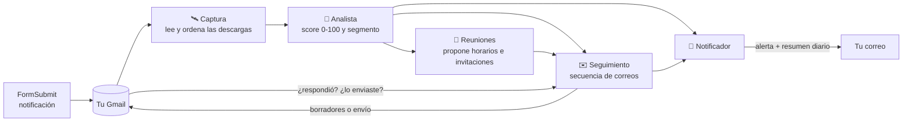
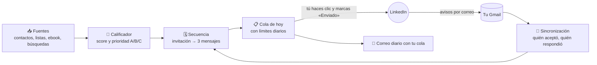

# Copahue · herramientas de finanzas

| App | Para qué sirve | Cómo se ejecuta |
|---|---|---|
| `tablero_ebook.py` | **Tablero con agentes** que analizan las descargas del ebook, te avisan por correo, hacen seguimiento y generan reuniones con potenciales clientes | `streamlit run tablero_ebook.py` |
| `tablero_linkedin.py` | **Prospector de LinkedIn**: califica prospectos, redacta invitaciones y mensajes, y te arma la cola diaria para ofrecer finanzas fraccionales | `streamlit run tablero_linkedin.py` |
| `app.py` | Generador de reportes Forpay (cuotas por empresa a Excel) | `streamlit run app.py` |
| `grok.py` | Chat con tus documentos PDF (Groq + Gemini) | `streamlit run grok.py` |

---

## 📘 Tablero de agentes del ebook

Cada vez que alguien descarga el ebook desde tu sitio, FormSubmit te envía a Gmail un correo
**«Nueva descarga del ebook — Hyperion»** con nombre, correo, teléfono, cargo, empresa y motivo de descarga.
Los agentes leen esos correos y hacen el trabajo comercial por ti:



| Agente | Qué hace |
|---|---|
| **Captura** | Lee en Gmail las notificaciones de FormSubmit (o un CSV/Excel), evita duplicados y detecta descargas repetidas. |
| **Analista** | Puntúa cada lead (correo corporativo, cargo, empresa, motivo, país, teléfono, descargas repetidas, si respondió) y lo clasifica en 🔥 Caliente, 🌤️ Tibio o ❄️ Frío. Escribe una lectura comercial y cómo abordarlo. Resume tendencias. |
| **Seguimiento** | Arma una secuencia de 4 correos según el segmento (bienvenida → contenido de valor → invitación → último contacto). Los deja como **borradores en tu Gmail**, los envía solo o espera tu aprobación. Se detiene apenas el lead responde. |
| **Reuniones** | A los calientes y a quienes respondieron les propone 3 horarios hábiles. Genera el evento de Google Calendar con el lead como invitado, el archivo `.ics`, el link de WhatsApp y exporta los contactos a tu CRM (CSV compatible con HubSpot). |
| **Notificador** | Te envía una **alerta inmediata** cuando aparece un lead caliente o alguien te responde (con botones para responder, escribir por WhatsApp o agendar) y un **resumen diario** con las cifras del día. |

### Puesta en marcha (10 minutos)

```bash
pip install -r requirements.txt
cp .env.example .env          # completa GMAIL_USER y GMAIL_APP_PASSWORD
streamlit run tablero_ebook.py
```

1. **Contraseña de aplicación de Gmail**: activa la verificación en 2 pasos y crea una en
   <https://myaccount.google.com/apppasswords>. Pégala en `GMAIL_APP_PASSWORD`. (IMAP viene activo por defecto en Gmail.)
2. Abre el tablero y presiona **▶️ Ejecutar agentes ahora**: leerá las descargas de los últimos 120 días.
3. ¿Quieres verlo antes de conectar Gmail? En la barra lateral, **🧪 Datos de demostración → Cargar demo**
   (leads ficticios con dominios `.example`, que nunca reciben correos).

Personaliza en `.env` tu firma, el nombre del ebook, la oferta de reunión y, si tienes Calendly o
agenda de citas de Google, `LINK_AGENDA` (los correos usarán ese link en vez de proponer horarios).

### Modos de seguimiento

| Modo | Qué pasa con cada correo a un lead |
|---|---|
| `borradores` *(recomendado)* | Queda listo en **Borradores** de tu Gmail. Tú lo revisas y lo envías; el agente detecta que lo enviaste y sigue con el próximo paso. |
| `automatico` | Se envía solo, con un máximo de `SEGUIMIENTO_MAX_DIA` correos al día (primero los más calientes). |
| `manual` | Espera tu aprobación en la pestaña **✉️ Seguimiento** del tablero. |

Puedes cambiar el modo en la barra lateral del tablero. Los leads que descargaron hace más de 3 días y
nunca contactaste reciben un correo de **reactivación** (en vez de la bienvenida); los de más de 60 días quedan
para gestión manual, para no escribir en masa a una base antigua.

### Que trabajen solos las 24 horas

Elige una opción (no las dos con el mismo Gmail, para no duplicar borradores):

- **Tu PC o un servidor**: `python run_agentes.py --loop 15` revisa Gmail cada 15 minutos.
  El tablero (`streamlit run tablero_ebook.py`) lee la misma base de datos.
- **GitHub Actions** (gratis, sin PC encendido): el flujo `.github/workflows/agentes-ebook.yml` corre cada 30 minutos.
  En *Settings → Secrets and variables → Actions* crea los secrets `GMAIL_USER`, `GMAIL_APP_PASSWORD`
  (y opcionalmente `NOTIFY_EMAIL`, `ANTHROPIC_API_KEY`) y la variable `AGENTES_ACTIVOS=true`.
  Recibirás las alertas y el resumen por correo, y los borradores aparecerán en tu Gmail. En este modo
  el tablero es para consultar: usa allí el modo `manual` y gestiona los correos desde Gmail.

Comandos útiles:

```bash
python run_agentes.py              # un ciclo
python run_agentes.py --resumen    # fuerza el resumen diario
python run_agentes.py --sin-notificar
python run_agentes.py --demo       # carga datos ficticios
```

### IA opcional (Claude)

Con `ANTHROPIC_API_KEY`, el analista escribe una lectura más fina de los leads calientes y tibios, y
el agente de seguimiento personaliza cada correo (sin inventar datos y conservando horarios y links).
Usa el modelo `claude-opus-5-5` con esfuerzo bajo y respaldo automático del servidor (`fallbacks: "default"`)
si una solicitud es rechazada. Sin API key todo funciona igual con reglas y plantillas.

### ¿Cómo se calcula el score?

| Factor | Puntos |
|---|---|
| Correo corporativo (no Gmail/Hotmail/Outlook…) | +20 |
| Cargo: decisor (gerente, CFO, socio, fundador, dueño…) / jefatura / especialista / otro | +30 / +20 / +10 / +5 |
| Informó su empresa (independiente: +5) | +10 |
| Motivo: necesidad en su empresa / consultor-asesor / aprendizaje / otro | +25 / +10 / +3 / +5 |
| Dejó teléfono | +5 |
| País en `MERCADO_OBJETIVO` (por prefijo telefónico o dominio) | +10 |
| Descargó más de una vez | +10 |
| Respondió un correo | +25 |
| Descarga en los últimos 3 días | +5 |

🔥 Caliente ≥ `UMBRAL_CALIENTE` (70) · 🌤️ Tibio ≥ `UMBRAL_TIBIO` (40) · ❄️ Frío el resto.
Las reglas están en `agentes_ebook/analista.py` y las plantillas de correo en `agentes_ebook/plantillas.py`.

### Privacidad y seguridad

- Los datos de tus leads se guardan solo en `data/tablero_ebook.db` (ignorado por git) y, si usas Actions, en su caché privada.
- Las credenciales van en `.env` o en los Secrets de Streamlit/GitHub, nunca en el código.
- Los agentes leen Gmail en modo solo lectura (no marcan correos como leídos) y solo escriben borradores o
  envían correos según el modo que elijas.

### Pruebas

```bash
pip install pytest
pytest -q
```

Estructura:

```
agentes_ebook/
  config.py        configuración desde .env / secrets
  db.py            base SQLite: leads, descargas, seguimientos, reuniones, bitácora
  gmail.py         IMAP/SMTP: lee FormSubmit, detecta respuestas, crea borradores, envía
  captura.py       agente de captura (Gmail, CSV, demo)
  analista.py      agente analista (score, segmento, hallazgos)
  plantillas.py    correos, cadencias, links de WhatsApp y mailto
  seguimiento.py   agente de seguimiento
  reuniones.py     agente de reuniones (horarios, Google Calendar, .ics, CRM)
  notificador.py   alertas y resumen diario por correo
  llm.py           IA opcional con Claude
  orquestador.py   ciclo completo de los agentes
tablero_ebook.py   tablero Streamlit
run_agentes.py     ejecución por terminal / cron / GitHub Actions
```

---

## 💼 Prospector de LinkedIn (finanzas fraccionales)

Un sistema de prospección para tu **perfil personal** de LinkedIn. Los agentes hacen todo el trabajo
de preparación y tú solo ejecutas el clic final:



| Automático | Lo haces tú (un clic por persona) |
|---|---|
| Importar y deduplicar prospectos, calificarlos contra tu cliente ideal | Abrir el perfil, pegar el texto y enviar |
| Redactar la nota de invitación (dentro del límite de caracteres) y los 3 mensajes | Marcar **✅ Enviado** en el tablero |
| Decidir a quién le toca hoy, en qué orden y sin pasar tus límites | Conversar cuando alguien responde |
| Detectar quién aceptó y quién respondió (lee los avisos de LinkedIn en tu Gmail) | |
| Programar los seguimientos (día 4 y día 8) y cerrar a quien no responde | |
| Enviarte por correo la cola del día y avisarte apenas alguien responde | |

> **¿Por qué no envía solo?** LinkedIn prohíbe en sus condiciones de uso los bots y extensiones que
> operan una cuenta (invitar, escribir o extraer datos de forma automática) y restringe los perfiles
> que los usan. Como se trata de tu perfil personal —tu principal activo comercial—, este prospector
> **nunca inicia sesión en LinkedIn ni actúa por ti allí**. Con la cola lista, enviar 15 invitaciones
> y 20 mensajes toma unos 10 minutos al día.

### Puesta en marcha

```bash
pip install -r requirements.txt
cp .env.example .env              # si aún no lo tienes; revisa la sección «Prospector de LinkedIn»
streamlit run tablero_linkedin.py
```

1. **Pruébalo primero**: barra lateral → **🧪 Datos de demostración → Cargar demo**.
2. **Suma prospectos** (pestaña **➕ Sumar prospectos**):
   - **Tus contactos**: en LinkedIn, *Yo → Ajustes y privacidad → Privacidad de datos → Obtener una copia
     de tus datos → Contactos*. Sube el `Connections.csv` que te llega. A tus contactos se les escribe
     directo, sin invitación.
   - **Una lista** en CSV/Excel (Sales Navigator, Apollo, un gremio, tu CRM) con nombre, cargo, empresa y,
     ojalá, la URL del perfil.
   - **Los leads del ebook** calientes y tibios, con un botón.
   - **Búsquedas listas** de tus cargos objetivo en tu mercado; agregas a mano a quienes calcen o, con IA,
     pegas la página de resultados y se extraen solos.
3. **Trabaja la pestaña 📋 Hoy** cada mañana: *Abrir en LinkedIn → pegar → ✅ Enviado*.
4. **Conecta Gmail** (mismos `GMAIL_USER` y `GMAIL_APP_PASSWORD` del tablero del ebook) para que las
   aceptaciones y respuestas se detecten solas y recibas la cola por correo. Debe ser el Gmail donde
   LinkedIn te envía sus avisos, con las notificaciones por correo de invitaciones y mensajes activadas.

Para que trabaje sin abrir el tablero (sincroniza, planifica y te envía la cola diaria):

```bash
python run_prospector.py --loop 30                   # un ciclo cada 30 minutos
python run_prospector.py --importar Connections.csv  # importar desde la terminal
python run_prospector.py --ebook                     # sumar leads del ebook
python run_prospector.py --ver                       # ver la cola de hoy en la terminal
python run_prospector.py --demo                      # datos ficticios
```

El tablero y `run_prospector.py` deben usar el mismo archivo `data/tablero_ebook.db` (misma máquina),
porque es en el tablero donde marcas lo enviado.

### La secuencia

| Paso | Cuándo | Qué dice |
|---|---|---|
| Invitación | Al entrar a la cola (solo no contactos) | Nota breve y sin venta, dentro de `LI_NOTA_MAX` caracteres |
| Mensaje 1 | Al aceptar (o de inmediato si ya era contacto) | Qué haces en una línea + una pregunta sobre su flujo de caja y reportes |
| Mensaje 2 | 4 días después, si no respondió | Las tres preguntas típicas de una empresa que crece + tu material (`LI_RECURSO_LINK`) |
| Mensaje 3 | 8 días después | Invitación directa a tu `OFERTA_REUNION` (con `LINK_AGENDA` si lo tienes) y cierre amable |

Si responde, la secuencia se detiene y el tablero te sugiere el mensaje para proponer la reunión.
Si no acepta en `LI_DIAS_RETIRAR` días o no responde tras el último mensaje, pasa a **Sin respuesta**.
Cada texto se puede editar antes de enviarlo; con `ANTHROPIC_API_KEY`, la IA personaliza los de la cola del día.

### ¿Cómo se califica un prospecto?

| Factor | Puntos |
|---|---|
| Cargo: decisor (gerente general, CEO, fundador, socio, dueño…) / finanzas / otra gerencia / jefatura / otro | +40 / +25 / +20 / +10 / +5 |
| Cargo dentro de `LI_CARGOS_OBJETIVO` | +10 |
| Informa su empresa | +10 |
| Está en tu `MERCADO_OBJETIVO` | +15 |
| Industria dentro de `LI_INDUSTRIAS_OBJETIVO` | +10 |
| Ya es tu contacto | +10 |
| Descargó tu ebook | +15 |
| Cargo con un término de `LI_EXCLUIR` (estudiantes, quienes buscan empleo, otros CFO fraccionales…) | Excluido |

**A** ≥ `LI_UMBRAL_A` (70) · **B** ≥ `LI_UMBRAL_B` (45) · **C** el resto. Entran a la cola las prioridades
hasta `LI_PRIORIDAD_MINIMA` (por defecto A y B), primero los puntajes más altos.

### Límites y buenas prácticas

- Por defecto: **15 invitaciones al día, 80 en 7 días y 20 mensajes al día**. Son conservadores a propósito;
  súbelos de a poco y solo si tu tasa de aceptación es buena (sobre 30 %).
- Las cuentas gratuitas de LinkedIn permiten pocas invitaciones con nota al mes y notas más cortas
  (`LI_NOTA_MAX=200`; con Premium, 300). Si se te acaban, envía la invitación sin nota: la secuencia sigue igual.
- Retira las invitaciones que nadie aceptó (el tablero te lo recuerda en las notas del prospecto).
- La detección por Gmail lee solo remitente, asunto y fecha de los avisos de LinkedIn. Es de mejor esfuerzo:
  si un aviso cambia de formato o hay dos prospectos con el mismo nombre, no adivina, y puedes marcar
  **🤝 Aceptó** o **🙌 Respondió** a mano.

Estructura:

```
prospector_linkedin/
  config.py        cliente ideal, oferta, límites y cadencia (variables LI_* del .env)
  db.py            tablas li_prospectos y li_acciones (en el mismo archivo .db de los agentes)
  fuentes.py       importación: contactos de LinkedIn, CSV/Excel, ebook, búsquedas, alta manual
  calificador.py   score y prioridad A/B/C
  mensajes.py      nota de invitación, secuencia de mensajes y propuesta de reunión
  secuencia.py     plan por prospecto, cola diaria y límites
  sincronizar.py   lee los avisos de LinkedIn en tu Gmail (aceptó / respondió)
  notificador.py   correo con la cola diaria y aviso de novedades
  llm.py           personalización opcional con Claude
  orquestador.py   ciclo completo y demo
```
