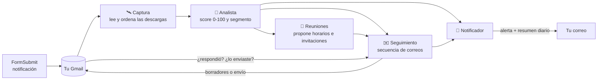

# Copahue · herramientas de finanzas

| App | Para qué sirve | Cómo se ejecuta |
|---|---|---|
| `tablero_ebook.py` | **Tablero con agentes** que analizan las descargas del ebook, te avisan por correo, hacen seguimiento y generan reuniones con potenciales clientes | `streamlit run tablero_ebook.py` |
| `app.py` | Generador de reportes Forpay (cuotas por empresa a Excel) | `streamlit run app.py` |
| `grok.py` | Chat con tus documentos PDF (Groq + Gemini) | `streamlit run grok.py` |
| `run_ayuno.py` | **Agente de ayuno intermitente** que te escribe al celular (Telegram, WhatsApp o ntfy) cuando abre y cierra tu ventana de comida | GitHub Actions o `python run_ayuno.py --loop` |

---

## 📘 Tablero de agentes del ebook

Cada vez que alguien descarga el ebook desde tu sitio, FormSubmit te envía a Gmail un correo
**«Nueva descarga del ebook — Hyperion»** con nombre, correo, teléfono, cargo, empresa y motivo de descarga.
Los agentes leen esos correos y hacen el trabajo comercial por ti:



| Agente | Qué hace |
|---|---|
| **Captura** | Lee en Gmail las notificaciones de FormSubmit (o un CSV/Excel), evita duplicados y detecta descargas repetidas. |
| **Analista** | Puntúa cada lead (correo corporativo, cargo, empresa, motivo, país, teléfono, descargas repetidas, si respondió) y lo clasifica en 🔥 Caliente, 🌤️ Tibio o ❄️ Frío. Escribe una lectura comercial y cómo abordarlo. Resume tendencias. |
| **Seguimiento** | Arma una secuencia de 4 correos según el segmento (bienvenida → contenido de valor → invitación → último contacto). Los deja como **borradores en tu Gmail**, los envía solo o espera tu aprobación. Se detiene apenas el lead responde. |
| **Reuniones** | A los calientes y a quienes respondieron les propone 3 horarios hábiles. Genera el evento de Google Calendar con el lead como invitado, el archivo `.ics`, el link de WhatsApp y exporta los contactos a tu CRM (CSV compatible con HubSpot). |
| **Notificador** | Te envía una **alerta inmediata** cuando aparece un lead caliente o alguien te responde (con botones para responder, escribir por WhatsApp o agendar) y un **resumen diario** con las cifras del día. |

### Puesta en marcha (10 minutos)

```bash
pip install -r requirements.txt
cp .env.example .env          # completa GMAIL_USER y GMAIL_APP_PASSWORD
streamlit run tablero_ebook.py
```

1. **Contraseña de aplicación de Gmail**: activa la verificación en 2 pasos y crea una en
   <https://myaccount.google.com/apppasswords>. Pégala en `GMAIL_APP_PASSWORD`. (IMAP viene activo por defecto en Gmail.)
2. Abre el tablero y presiona **▶️ Ejecutar agentes ahora**: leerá las descargas de los últimos 120 días.
3. ¿Quieres verlo antes de conectar Gmail? En la barra lateral, **🧪 Datos de demostración → Cargar demo**
   (leads ficticios con dominios `.example`, que nunca reciben correos).

Personaliza en `.env` tu firma, el nombre del ebook, la oferta de reunión y, si tienes Calendly o
agenda de citas de Google, `LINK_AGENDA` (los correos usarán ese link en vez de proponer horarios).

### Modos de seguimiento

| Modo | Qué pasa con cada correo a un lead |
|---|---|
| `borradores` *(recomendado)* | Queda listo en **Borradores** de tu Gmail. Tú lo revisas y lo envías; el agente detecta que lo enviaste y sigue con el próximo paso. |
| `automatico` | Se envía solo, con un máximo de `SEGUIMIENTO_MAX_DIA` correos al día (primero los más calientes). |
| `manual` | Espera tu aprobación en la pestaña **✉️ Seguimiento** del tablero. |

Puedes cambiar el modo en la barra lateral del tablero. Los leads que descargaron hace más de 3 días y
nunca contactaste reciben un correo de **reactivación** (en vez de la bienvenida); los de más de 60 días quedan
para gestión manual, para no escribir en masa a una base antigua.

### Que trabajen solos las 24 horas

Elige una opción (no las dos con el mismo Gmail, para no duplicar borradores):

- **Tu PC o un servidor**: `python run_agentes.py --loop 15` revisa Gmail cada 15 minutos.
  El tablero (`streamlit run tablero_ebook.py`) lee la misma base de datos.
- **GitHub Actions** (gratis, sin PC encendido): el flujo `.github/workflows/agentes-ebook.yml` corre cada 30 minutos.
  En *Settings → Secrets and variables → Actions* crea los secrets `GMAIL_USER`, `GMAIL_APP_PASSWORD`
  (y opcionalmente `NOTIFY_EMAIL`, `ANTHROPIC_API_KEY`) y la variable `AGENTES_ACTIVOS=true`.
  Recibirás las alertas y el resumen por correo, y los borradores aparecerán en tu Gmail. En este modo
  el tablero es para consultar: usa allí el modo `manual` y gestiona los correos desde Gmail.

Comandos útiles:

```bash
python run_agentes.py              # un ciclo
python run_agentes.py --resumen    # fuerza el resumen diario
python run_agentes.py --sin-notificar
python run_agentes.py --demo       # carga datos ficticios
```

### IA opcional (Claude)

Con `ANTHROPIC_API_KEY`, el analista escribe una lectura más fina de los leads calientes y tibios, y
el agente de seguimiento personaliza cada correo (sin inventar datos y conservando horarios y links).
Usa el modelo `claude-opus-5-5` con esfuerzo bajo y respaldo automático del servidor (`fallbacks: "default"`)
si una solicitud es rechazada. Sin API key todo funciona igual con reglas y plantillas.

### ¿Cómo se calcula el score?

| Factor | Puntos |
|---|---|
| Correo corporativo (no Gmail/Hotmail/Outlook…) | +20 |
| Cargo: decisor (gerente, CFO, socio, fundador, dueño…) / jefatura / especialista / otro | +30 / +20 / +10 / +5 |
| Informó su empresa (independiente: +5) | +10 |
| Motivo: necesidad en su empresa / consultor-asesor / aprendizaje / otro | +25 / +10 / +3 / +5 |
| Dejó teléfono | +5 |
| País en `MERCADO_OBJETIVO` (por prefijo telefónico o dominio) | +10 |
| Descargó más de una vez | +10 |
| Respondió un correo | +25 |
| Descarga en los últimos 3 días | +5 |

🔥 Caliente ≥ `UMBRAL_CALIENTE` (70) · 🌤️ Tibio ≥ `UMBRAL_TIBIO` (40) · ❄️ Frío el resto.
Las reglas están en `agentes_ebook/analista.py` y las plantillas de correo en `agentes_ebook/plantillas.py`.

### Privacidad y seguridad

- Los datos de tus leads se guardan solo en `data/tablero_ebook.db` (ignorado por git) y, si usas Actions, en su caché privada.
- Las credenciales van en `.env` o en los Secrets de Streamlit/GitHub, nunca en el código.
- Los agentes leen Gmail en modo solo lectura (no marcan correos como leídos) y solo escriben borradores o
  envían correos según el modo que elijas.

### Pruebas

```bash
pip install pytest
pytest -q
```

Estructura:

```
agentes_ebook/
  config.py        configuración desde .env / secrets
  db.py            base SQLite: leads, descargas, seguimientos, reuniones, bitácora
  gmail.py         IMAP/SMTP: lee FormSubmit, detecta respuestas, crea borradores, envía
  captura.py       agente de captura (Gmail, CSV, demo)
  analista.py      agente analista (score, segmento, hallazgos)
  plantillas.py    correos, cadencias, links de WhatsApp y mailto
  seguimiento.py   agente de seguimiento
  reuniones.py     agente de reuniones (horarios, Google Calendar, .ics, CRM)
  notificador.py   alertas y resumen diario por correo
  llm.py           IA opcional con Claude
  orquestador.py   ciclo completo de los agentes
tablero_ebook.py   tablero Streamlit
run_agentes.py     ejecución por terminal / cron / GitHub Actions
```

---

## 🍽️ Agente de ayuno intermitente

Te escribe al celular para acompañar tu plan de ayuno (16:8, 18:6, 14:10…). Con la ventana por
defecto (**comes de 12:00 a 20:00**, hora de Chile) recibes cada día:

| Hora | Aviso (`AYUNO_AVISOS`) | Ejemplo |
|---|---|---|
| 08:00 | `manana` | ☀️ Buenos días. Llevas 12 h de ayuno y te faltan 4 h: tu ventana abre a las 12:00. *(+ un consejo del día)* |
| 11:30 | `apertura_previa` | ⏳ En 30 min abres tu ventana de comida (12:00 a 20:00). Rompe el ayuno con proteína y verduras… |
| 12:00 | `apertura` | 🍽️ ¡Lo lograste! Completaste 16 h de ayuno. Tu ventana está abierta hasta las 20:00. |
| 19:30 | `cierre_previo` | 🕗 Te quedan 30 min de ventana: cierra a las 20:00. Buen momento para tu última comida del día. |
| 20:00 | `inicio_ayuno` | 🌙 Comienza tu ayuno de 16 h. Tu próxima comida es mañana a las 12:00. |

Los tiempos se calculan en el momento del envío (si un aviso sale 8 minutos tarde, dice «en 22 min»), se
respetan los cambios de horario y ningún aviso se repite. Con `ANTHROPIC_API_KEY`, Claude reescribe cada
mensaje para que no suene igual todos los días (las horas no las puede cambiar: si lo intenta, se usa la plantilla).

### 1. Elige por dónde te escribe

**Telegram (recomendado: gratis, oficial e inmediato)**

1. En Telegram busca **@BotFather**, envíale `/newbot` y sigue los pasos. Te entrega un *token* (`123456:ABC…`).
2. Abre tu bot nuevo y envíale «hola».
3. Obtén tu chat id: `TELEGRAM_BOT_TOKEN=<token> python run_ayuno.py --chat-id`
   (o abre `https://api.telegram.org/bot<token>/getUpdates` en el navegador y busca `"chat":{"id":…}`).

**WhatsApp (vía [CallMeBot](https://www.callmebot.com/blog/free-api-whatsapp-messages/), gratis para uso personal)**

Sigue las instrucciones de su página: agregas su número a tus contactos, le envías el mensaje de
autorización y te responde con tu `APIKEY`. Es un servicio de terceros no oficial: puede tener demoras.

**Notificación push con [ntfy](https://ntfy.sh)** (sin cuenta)

Instala la app ntfy, suscríbete a un tema con un nombre largo y difícil de adivinar (por ejemplo
`ayuno-x7k2p9q4`) y usa ese mismo nombre en `NTFY_TEMA`. Quien conozca el tema puede leer los avisos.

Puedes configurar más de un canal: el agente escribe por todos.

### 2. Actívalo en GitHub Actions (sin PC encendido)

El flujo `.github/workflows/ayuno.yml` despierta cada 15 minutos y, si un aviso cae en los próximos 14,
espera su hora exacta. En *Settings → Secrets and variables → Actions*:

- **Secrets** (los de tu canal): `TELEGRAM_BOT_TOKEN` y `TELEGRAM_CHAT_ID`, o `WHATSAPP_TELEFONO`
  (con código de país, `+569…`) y `CALLMEBOT_APIKEY`, o `NTFY_TEMA`. Opcional: `ANTHROPIC_API_KEY`.
- **Variables**: `AYUNO_ACTIVO` = `true` y, si quieres cambiar tu plan, las de la tabla de abajo.

Luego ve a *Actions → Agente de ayuno → Run workflow* (con «Enviar un mensaje de prueba» marcado):
debería llegarte «✅ Tu agente de ayuno está conectado» al celular.

> **Ojo:** GitHub desactiva los flujos programados de un repositorio público tras 60 días sin actividad
> (te avisa por correo antes). Si pasa, reactívalo desde la pestaña *Actions*. Como los registros de un
> repositorio público son visibles, el agente no escribe allí tus horarios ni tus mensajes.

**¿Prefieres tu PC o un servidor?** Completa `.env` y ejecuta `python run_ayuno.py --loop` (revisa cada minuto).
Usa una sola opción para no recibir los avisos dos veces.

### 3. Ajusta tu plan

| Variable | Por defecto | Para qué |
|---|---|---|
| `AYUNO_VENTANA_INICIO` | `12:00` | Hora en que abres tu ventana de comida |
| `AYUNO_VENTANA_FIN` | `20:00` | Hora en que la cierras (empieza el ayuno). Puede cruzar la medianoche |
| `AYUNO_DIAS` | `todos` | Días en que termina un ayuno: `lunes a viernes`, `lun,mie,vie`… |
| `AYUNO_AVISOS` | `todos` | Cuáles quieres: `manana`, `apertura_previa`, `apertura`, `cierre_previo`, `inicio_ayuno` |
| `AYUNO_HORA_MANANA` | `08:00` | Hora del buenos días (solo si cae dentro del ayuno) |
| `AYUNO_AVISO_PREVIO_MIN` | `30` | Anticipación de los avisos «falta poco» (`0` los desactiva) |
| `AYUNO_NOMBRE` | — | Cómo quieres que te salude |
| `ZONA_HORARIA` | `America/Santiago` | Tu zona horaria |

Ejemplo 18:6 de lunes a viernes: `AYUNO_VENTANA_INICIO=13:00`, `AYUNO_VENTANA_FIN=19:00`, `AYUNO_DIAS=lunes a viernes`.

```bash
python run_ayuno.py --plan      # muestra los avisos de hoy y mañana con su texto (no envía nada)
python run_ayuno.py --prueba    # envía un mensaje de prueba
python run_ayuno.py --sin-ia    # usa plantillas aunque haya ANTHROPIC_API_KEY
```

Con Claude (`claude-opus-5-5`, esfuerzo bajo y respaldo automático del servidor `fallbacks: "default"`),
cinco avisos al día cuestan del orden de 1 a 2 USD al mes. Sin API key funciona igual con plantillas.

> El agente es un recordatorio, no un consejo médico. Si tienes diabetes, tomas medicamentos, estás
> embarazada o en lactancia, o tienes antecedentes de trastornos alimentarios, consulta a tu médico antes
> de ayunar. Si sientes malestar, come: tu salud va primero.

```
ayuno/
  config.py     tu plan y tus canales desde .env / secrets
  plan.py       calendario de avisos (zona horaria, caducidad, días)
  mensajes.py   plantillas y redacción opcional con Claude
  canales.py    Telegram, WhatsApp (CallMeBot) y ntfy
  estado.py     memoria de avisos enviados
  agente.py     ciclo del agente
run_ayuno.py    ejecución por terminal / GitHub Actions
```
