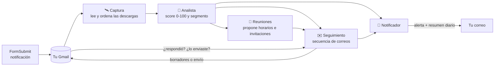

# Copahue · herramientas de finanzas

| App | Para qué sirve | Cómo se ejecuta |
|---|---|---|
| `tablero_ebook.py` | **Tablero con agentes** que analizan las descargas del ebook, te avisan por correo, hacen seguimiento y generan reuniones con potenciales clientes | `streamlit run tablero_ebook.py` |
| `app.py` | Generador de reportes Forpay (cuotas por empresa a Excel) | `streamlit run app.py` |
| `grok.py` | Chat con tus documentos PDF (Groq + Gemini) | `streamlit run grok.py` |
| `tablero_trading.py` | **Agente de trading automático** que elige ETFs por momentum, controla el riesgo y opera solo cada día (cartera simulada por defecto; Alpaca opcional) | `streamlit run tablero_trading.py` |

---

## 📘 Tablero de agentes del ebook

Cada vez que alguien descarga el ebook desde tu sitio, FormSubmit te envía a Gmail un correo
**«Nueva descarga del ebook — Hyperion»** con nombre, correo, teléfono, cargo, empresa y motivo de descarga.
Los agentes leen esos correos y hacen el trabajo comercial por ti:



| Agente | Qué hace |
|---|---|
| **Captura** | Lee en Gmail las notificaciones de FormSubmit (o un CSV/Excel), evita duplicados y detecta descargas repetidas. |
| **Analista** | Puntúa cada lead (correo corporativo, cargo, empresa, motivo, país, teléfono, descargas repetidas, si respondió) y lo clasifica en 🔥 Caliente, 🌤️ Tibio o ❄️ Frío. Escribe una lectura comercial y cómo abordarlo. Resume tendencias. |
| **Seguimiento** | Arma una secuencia de 4 correos según el segmento (bienvenida → contenido de valor → invitación → último contacto). Los deja como **borradores en tu Gmail**, los envía solo o espera tu aprobación. Se detiene apenas el lead responde. |
| **Reuniones** | A los calientes y a quienes respondieron les propone 3 horarios hábiles. Genera el evento de Google Calendar con el lead como invitado, el archivo `.ics`, el link de WhatsApp y exporta los contactos a tu CRM (CSV compatible con HubSpot). |
| **Notificador** | Te envía una **alerta inmediata** cuando aparece un lead caliente o alguien te responde (con botones para responder, escribir por WhatsApp o agendar) y un **resumen diario** con las cifras del día. |

### Puesta en marcha (10 minutos)

```bash
pip install -r requirements.txt
cp .env.example .env          # completa GMAIL_USER y GMAIL_APP_PASSWORD
streamlit run tablero_ebook.py
```

1. **Contraseña de aplicación de Gmail**: activa la verificación en 2 pasos y crea una en
   <https://myaccount.google.com/apppasswords>. Pégala en `GMAIL_APP_PASSWORD`. (IMAP viene activo por defecto en Gmail.)
2. Abre el tablero y presiona **▶️ Ejecutar agentes ahora**: leerá las descargas de los últimos 120 días.
3. ¿Quieres verlo antes de conectar Gmail? En la barra lateral, **🧪 Datos de demostración → Cargar demo**
   (leads ficticios con dominios `.example`, que nunca reciben correos).

Personaliza en `.env` tu firma, el nombre del ebook, la oferta de reunión y, si tienes Calendly o
agenda de citas de Google, `LINK_AGENDA` (los correos usarán ese link en vez de proponer horarios).

### Modos de seguimiento

| Modo | Qué pasa con cada correo a un lead |
|---|---|
| `borradores` *(recomendado)* | Queda listo en **Borradores** de tu Gmail. Tú lo revisas y lo envías; el agente detecta que lo enviaste y sigue con el próximo paso. |
| `automatico` | Se envía solo, con un máximo de `SEGUIMIENTO_MAX_DIA` correos al día (primero los más calientes). |
| `manual` | Espera tu aprobación en la pestaña **✉️ Seguimiento** del tablero. |

Puedes cambiar el modo en la barra lateral del tablero. Los leads que descargaron hace más de 3 días y
nunca contactaste reciben un correo de **reactivación** (en vez de la bienvenida); los de más de 60 días quedan
para gestión manual, para no escribir en masa a una base antigua.

### Que trabajen solos las 24 horas

Elige una opción (no las dos con el mismo Gmail, para no duplicar borradores):

- **Tu PC o un servidor**: `python run_agentes.py --loop 15` revisa Gmail cada 15 minutos.
  El tablero (`streamlit run tablero_ebook.py`) lee la misma base de datos.
- **GitHub Actions** (gratis, sin PC encendido): el flujo `.github/workflows/agentes-ebook.yml` corre cada 30 minutos.
  En *Settings → Secrets and variables → Actions* crea los secrets `GMAIL_USER`, `GMAIL_APP_PASSWORD`
  (y opcionalmente `NOTIFY_EMAIL`, `ANTHROPIC_API_KEY`) y la variable `AGENTES_ACTIVOS=true`.
  Recibirás las alertas y el resumen por correo, y los borradores aparecerán en tu Gmail. En este modo
  el tablero es para consultar: usa allí el modo `manual` y gestiona los correos desde Gmail.

Comandos útiles:

```bash
python run_agentes.py              # un ciclo
python run_agentes.py --resumen    # fuerza el resumen diario
python run_agentes.py --sin-notificar
python run_agentes.py --demo       # carga datos ficticios
```

### IA opcional (Claude)

Con `ANTHROPIC_API_KEY`, el analista escribe una lectura más fina de los leads calientes y tibios, y
el agente de seguimiento personaliza cada correo (sin inventar datos y conservando horarios y links).
Usa el modelo `claude-opus-5-5` con esfuerzo bajo y respaldo automático del servidor (`fallbacks: "default"`)
si una solicitud es rechazada. Sin API key todo funciona igual con reglas y plantillas.

### ¿Cómo se calcula el score?

| Factor | Puntos |
|---|---|
| Correo corporativo (no Gmail/Hotmail/Outlook…) | +20 |
| Cargo: decisor (gerente, CFO, socio, fundador, dueño…) / jefatura / especialista / otro | +30 / +20 / +10 / +5 |
| Informó su empresa (independiente: +5) | +10 |
| Motivo: necesidad en su empresa / consultor-asesor / aprendizaje / otro | +25 / +10 / +3 / +5 |
| Dejó teléfono | +5 |
| País en `MERCADO_OBJETIVO` (por prefijo telefónico o dominio) | +10 |
| Descargó más de una vez | +10 |
| Respondió un correo | +25 |
| Descarga en los últimos 3 días | +5 |

🔥 Caliente ≥ `UMBRAL_CALIENTE` (70) · 🌤️ Tibio ≥ `UMBRAL_TIBIO` (40) · ❄️ Frío el resto.
Las reglas están en `agentes_ebook/analista.py` y las plantillas de correo en `agentes_ebook/plantillas.py`.

### Privacidad y seguridad

- Los datos de tus leads se guardan solo en `data/tablero_ebook.db` (ignorado por git) y, si usas Actions, en su caché privada.
- Las credenciales van en `.env` o en los Secrets de Streamlit/GitHub, nunca en el código.
- Los agentes leen Gmail en modo solo lectura (no marcan correos como leídos) y solo escriben borradores o
  envían correos según el modo que elijas.

### Pruebas

```bash
pip install pytest
pytest -q
```

Estructura:

```
agentes_ebook/
  config.py        configuración desde .env / secrets
  db.py            base SQLite: leads, descargas, seguimientos, reuniones, bitácora
  gmail.py         IMAP/SMTP: lee FormSubmit, detecta respuestas, crea borradores, envía
  captura.py       agente de captura (Gmail, CSV, demo)
  analista.py      agente analista (score, segmento, hallazgos)
  plantillas.py    correos, cadencias, links de WhatsApp y mailto
  seguimiento.py   agente de seguimiento
  reuniones.py     agente de reuniones (horarios, Google Calendar, .ics, CRM)
  notificador.py   alertas y resumen diario por correo
  llm.py           IA opcional con Claude
  orquestador.py   ciclo completo de los agentes
tablero_ebook.py   tablero Streamlit
run_agentes.py     ejecución por terminal / cron / GitHub Actions
```


---

## 📈 Agente de trading automático

Un agente que **opera solo cada día hábil** sobre una cartera de ETFs y te manda el informe por correo.
Por defecto trabaja con **dinero ficticio** (cartera simulada): así ves cómo se comporta durante semanas
antes de decidir si conectarlo a una cuenta real.

> ⚠️ **Ningún agente puede garantizar una ganancia.** Los mercados suben y bajan, y esta estrategia puede
> perder dinero. La prueba histórica (`--backtest`) te dice cuántas veces en el pasado habría alcanzado tu meta,
> no lo que pasará mañana. Nunca inviertas dinero que no puedas permitirte perder.

### Qué hace

| Paso | Regla |
|---|---|
| 1. Mide | Cada ~mes ordena los ETFs del universo (`SPY, QQQ, IWM, EFA, EEM, GLD, TLT, IEF`) por su rentabilidad de los últimos 6 meses. |
| 2. Elige | Compra solo los **3 mejores** que además estén **por encima de su media de 200 ruedas** y con rentabilidad positiva. Si ninguno cumple, se queda en efectivo. |
| 3. Pesa | Da más peso a los activos más tranquilos (peso inverso a la volatilidad) y deja un 2 % de efectivo. |
| 4. Protege | Cada día revisa un **stop-loss del 8 %** por posición y, si la cartera cae **15 % desde su máximo**, vende todo y espera un mes. |
| 5. Avisa | Te envía por Gmail el informe diario: patrimonio, ganancia frente a la meta, posiciones, operaciones y ranking. |

Las órdenes se deciden al cierre y se ejecutan en la **apertura siguiente**, tanto en el backtest como en vivo,
para que lo que ves en la prueba histórica sea lo que hará el agente.

### Puesta en marcha

```bash
pip install -r requirements.txt
python run_trading.py --demo        # sin internet: backtest y ciclo con precios ficticios
python run_trading.py --proyeccion  # escenarios de tu plan de aportes mensuales (sin internet)
python run_trading.py --backtest    # prueba histórica con precios reales (Stooq / Yahoo)
python run_trading.py               # un ciclo real: decide y guarda data/trading/cartera.json
streamlit run tablero_trading.py    # tablero con cartera, señal, operaciones y backtest
```

En `.env` ajusta `CAPITAL_INICIAL`, `META_USD` (la ganancia que quieres lograr, por defecto 1.000 USD),
`UNIVERSO`, `MAX_POSICIONES`, `STOP_LOSS_PCT` y `MAX_CAIDA_CARTERA_PCT`.

### Plan de aportes mensuales en pesos

Si vas a aportar una cantidad fija cada mes, dilo en `.env`:

```
CAPITAL_INICIAL=0
APORTE_MENSUAL_CLP=15000      # el agente lo suma a la cartera el primer día hábil de cada mes
META_MENSUAL_CLP=500000       # la renta mensual que quieres llegar a tener
```

El agente convierte el aporte a dólares con el dólar observado del Banco Central (mindicador.cl), lo invierte con
la misma estrategia y en cada informe separa **lo aportado** de **lo ganado**. `python run_trading.py --proyeccion`
muestra la tabla de escenarios: cuánto capital exige esa renta (regla del 4 %), cuántos años tomaría a distintas
rentabilidades y qué aporte haría falta para lograrlo en 5, 10 o 20 años.

Para que no haya sorpresas: una renta de 500.000 CLP al mes requiere unos **150 millones de CLP** de capital.
Con 15.000 CLP al mes y un 10 % anual (más que el promedio histórico de la bolsa) se tarda **~46 años**. El agente
no cambia esa aritmética; lo que hace es invertir con disciplina y mostrarte el avance real.

En modo `simulado` el aporte es ficticio; en `alpaca_papel`/`alpaca_real` los aportes son tus depósitos reales en
el broker (Alpaca opera en dólares: revisa costos de transferencia antes de enviar montos pequeños).

### Para que corra solo (GitHub Actions)

`.github/workflows/agente-trading.yml` ejecuta el agente **cada día hábil a las 21:30 UTC** (tras el cierre de Wall Street).
En *Settings → Secrets and variables → Actions*:

1. Variable `TRADING_ACTIVO = true` (sin ella no corre ni consume minutos).
2. Secrets `GMAIL_USER` y `GMAIL_APP_PASSWORD` para recibir el informe (los mismos del tablero del ebook).
3. Opcional: variables `TRADING_MODO`, `CAPITAL_INICIAL`, `META_USD`, `APORTE_MENSUAL_CLP`, `META_MENSUAL_CLP`, `UNIVERSO`, `AVISAR_SOLO_CON_OPERACIONES`.

La cartera se guarda entre ejecuciones en la caché de Actions y, además, se publica como artefacto `cartera-trading`.

### Modos de operación

| `TRADING_MODO` | Qué pasa |
|---|---|
| `simulado` (defecto) | Cartera ficticia en `data/trading/cartera.json`. Sin broker, sin riesgo. |
| `alpaca_papel` | Cuenta de práctica de [Alpaca](https://alpaca.markets) (dinero ficticio, mercado real). Necesita `ALPACA_API_KEY` y `ALPACA_SECRET_KEY`. |
| `alpaca_real` | Cuenta real de Alpaca. **Solo opera si además `CONFIRMO_DINERO_REAL=true`**; si falta, usa la cuenta de práctica. |

Recomendación: deja el modo `simulado` o `alpaca_papel` al menos 2-3 meses, compara el informe con el backtest
y recién entonces decide si pasar a dinero real, empezando con un capital pequeño.
