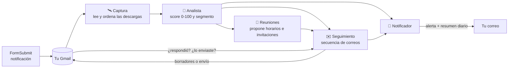
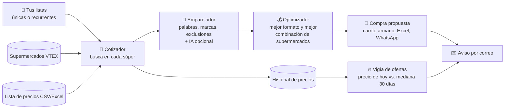

# Copahue · herramientas de finanzas

| App | Para qué sirve | Cómo se ejecuta |
|---|---|---|
| `tablero_super.py` | **Agente de compras de supermercado**: busca el mejor precio de tu lista en varios supermercados, optimiza dónde comprar y repite tus compras recurrentes | `streamlit run tablero_super.py` |
| `tablero_ebook.py` | **Tablero con agentes** que analizan las descargas del ebook, te avisan por correo, hacen seguimiento y generan reuniones con potenciales clientes | `streamlit run tablero_ebook.py` |
| `app.py` | Generador de reportes Forpay (cuotas por empresa a Excel) | `streamlit run app.py` |
| `grok.py` | Chat con tus documentos PDF (Groq + Gemini) | `streamlit run grok.py` |

---

## 📘 Tablero de agentes del ebook

Cada vez que alguien descarga el ebook desde tu sitio, FormSubmit te envía a Gmail un correo
**«Nueva descarga del ebook — Hyperion»** con nombre, correo, teléfono, cargo, empresa y motivo de descarga.
Los agentes leen esos correos y hacen el trabajo comercial por ti:



| Agente | Qué hace |
|---|---|
| **Captura** | Lee en Gmail las notificaciones de FormSubmit (o un CSV/Excel), evita duplicados y detecta descargas repetidas. |
| **Analista** | Puntúa cada lead (correo corporativo, cargo, empresa, motivo, país, teléfono, descargas repetidas, si respondió) y lo clasifica en 🔥 Caliente, 🌤️ Tibio o ❄️ Frío. Escribe una lectura comercial y cómo abordarlo. Resume tendencias. |
| **Seguimiento** | Arma una secuencia de 4 correos según el segmento (bienvenida → contenido de valor → invitación → último contacto). Los deja como **borradores en tu Gmail**, los envía solo o espera tu aprobación. Se detiene apenas el lead responde. |
| **Reuniones** | A los calientes y a quienes respondieron les propone 3 horarios hábiles. Genera el evento de Google Calendar con el lead como invitado, el archivo `.ics`, el link de WhatsApp y exporta los contactos a tu CRM (CSV compatible con HubSpot). |
| **Notificador** | Te envía una **alerta inmediata** cuando aparece un lead caliente o alguien te responde (con botones para responder, escribir por WhatsApp o agendar) y un **resumen diario** con las cifras del día. |

### Puesta en marcha (10 minutos)

```bash
pip install -r requirements.txt
cp .env.example .env          # completa GMAIL_USER y GMAIL_APP_PASSWORD
streamlit run tablero_ebook.py
```

1. **Contraseña de aplicación de Gmail**: activa la verificación en 2 pasos y crea una en
   <https://myaccount.google.com/apppasswords>. Pégala en `GMAIL_APP_PASSWORD`. (IMAP viene activo por defecto en Gmail.)
2. Abre el tablero y presiona **▶️ Ejecutar agentes ahora**: leerá las descargas de los últimos 120 días.
3. ¿Quieres verlo antes de conectar Gmail? En la barra lateral, **🧪 Datos de demostración → Cargar demo**
   (leads ficticios con dominios `.example`, que nunca reciben correos).

Personaliza en `.env` tu firma, el nombre del ebook, la oferta de reunión y, si tienes Calendly o
agenda de citas de Google, `LINK_AGENDA` (los correos usarán ese link en vez de proponer horarios).

### Modos de seguimiento

| Modo | Qué pasa con cada correo a un lead |
|---|---|
| `borradores` *(recomendado)* | Queda listo en **Borradores** de tu Gmail. Tú lo revisas y lo envías; el agente detecta que lo enviaste y sigue con el próximo paso. |
| `automatico` | Se envía solo, con un máximo de `SEGUIMIENTO_MAX_DIA` correos al día (primero los más calientes). |
| `manual` | Espera tu aprobación en la pestaña **✉️ Seguimiento** del tablero. |

Puedes cambiar el modo en la barra lateral del tablero. Los leads que descargaron hace más de 3 días y
nunca contactaste reciben un correo de **reactivación** (en vez de la bienvenida); los de más de 60 días quedan
para gestión manual, para no escribir en masa a una base antigua.

### Que trabajen solos las 24 horas

Elige una opción (no las dos con el mismo Gmail, para no duplicar borradores):

- **Tu PC o un servidor**: `python run_agentes.py --loop 15` revisa Gmail cada 15 minutos.
  El tablero (`streamlit run tablero_ebook.py`) lee la misma base de datos.
- **GitHub Actions** (gratis, sin PC encendido): el flujo `.github/workflows/agentes-ebook.yml` corre cada 30 minutos.
  En *Settings → Secrets and variables → Actions* crea los secrets `GMAIL_USER`, `GMAIL_APP_PASSWORD`
  (y opcionalmente `NOTIFY_EMAIL`, `ANTHROPIC_API_KEY`) y la variable `AGENTES_ACTIVOS=true`.
  Recibirás las alertas y el resumen por correo, y los borradores aparecerán en tu Gmail. En este modo
  el tablero es para consultar: usa allí el modo `manual` y gestiona los correos desde Gmail.

Comandos útiles:

```bash
python run_agentes.py              # un ciclo
python run_agentes.py --resumen    # fuerza el resumen diario
python run_agentes.py --sin-notificar
python run_agentes.py --demo       # carga datos ficticios
```

### IA opcional (Claude)

Con `ANTHROPIC_API_KEY`, el analista escribe una lectura más fina de los leads calientes y tibios, y
el agente de seguimiento personaliza cada correo (sin inventar datos y conservando horarios y links).
Usa el modelo `claude-opus-5-5` con esfuerzo bajo y respaldo automático del servidor (`fallbacks: "default"`)
si una solicitud es rechazada. Sin API key todo funciona igual con reglas y plantillas.

### ¿Cómo se calcula el score?

| Factor | Puntos |
|---|---|
| Correo corporativo (no Gmail/Hotmail/Outlook…) | +20 |
| Cargo: decisor (gerente, CFO, socio, fundador, dueño…) / jefatura / especialista / otro | +30 / +20 / +10 / +5 |
| Informó su empresa (independiente: +5) | +10 |
| Motivo: necesidad en su empresa / consultor-asesor / aprendizaje / otro | +25 / +10 / +3 / +5 |
| Dejó teléfono | +5 |
| País en `MERCADO_OBJETIVO` (por prefijo telefónico o dominio) | +10 |
| Descargó más de una vez | +10 |
| Respondió un correo | +25 |
| Descarga en los últimos 3 días | +5 |

🔥 Caliente ≥ `UMBRAL_CALIENTE` (70) · 🌤️ Tibio ≥ `UMBRAL_TIBIO` (40) · ❄️ Frío el resto.
Las reglas están en `agentes_ebook/analista.py` y las plantillas de correo en `agentes_ebook/plantillas.py`.

### Privacidad y seguridad

- Los datos de tus leads se guardan solo en `data/tablero_ebook.db` (ignorado por git) y, si usas Actions, en su caché privada.
- Las credenciales van en `.env` o en los Secrets de Streamlit/GitHub, nunca en el código.
- Los agentes leen Gmail en modo solo lectura (no marcan correos como leídos) y solo escriben borradores o
  envían correos según el modo que elijas.

### Pruebas

```bash
pip install pytest
pytest -q
```

Estructura:

```
agentes_ebook/
  config.py        configuración desde .env / secrets
  db.py            base SQLite: leads, descargas, seguimientos, reuniones, bitácora
  gmail.py         IMAP/SMTP: lee FormSubmit, detecta respuestas, crea borradores, envía
  captura.py       agente de captura (Gmail, CSV, demo)
  analista.py      agente analista (score, segmento, hallazgos)
  plantillas.py    correos, cadencias, links de WhatsApp y mailto
  seguimiento.py   agente de seguimiento
  reuniones.py     agente de reuniones (horarios, Google Calendar, .ics, CRM)
  notificador.py   alertas y resumen diario por correo
  llm.py           IA opcional con Claude
  orquestador.py   ciclo completo de los agentes
tablero_ebook.py   tablero Streamlit
run_agentes.py     ejecución por terminal / cron / GitHub Actions
```

---

## 🛒 Agente de compras de supermercado

Escribes lo que quieres comprar y cada cuánto; el agente busca cada producto en tus supermercados,
compara por **precio por kilo / litro / unidad**, decide **dónde conviene comprar cada cosa** (considerando
despacho, despacho gratis y compra mínima) y te deja la compra lista antes de cada fecha.



### Puesta en marcha

```bash
pip install -r requirements.txt
streamlit run tablero_super.py
```

1. **Pruébalo sin conectar nada**: barra lateral → **🧪 Datos de demostración → Cargar demo** (4 supermercados
   ficticios, 2 listas recurrentes y 8 semanas de historial; los precios son inventados).
2. **Tus supermercados** (pestaña 🏪): vienen sugeridos Jumbo, Santa Isabel, Unimarc y Alvi con el conector
   **VTEX**, desactivados. Actívalos, completa despacho / gratis desde / compra mínima y presiona
   **🔌 Probar conexión**. Puedes agregar cualquier otra tienda VTEX con su URL.
   Los sitios de los supermercados cambian seguido: si uno no responde, desactívalo o usa una lista de precios.
3. **Lista de precios propia** (CSV o Excel con columnas `tienda, producto, precio` y opcionalmente
   `marca, precio_normal, url`): sirve para el almacén del barrio, la feria o cualquier súper sin tienda compatible.
4. **Tus listas** (pestaña 📝): crea una lista, elige si se repite (semanal, quincenal, mensual) y presiona
   **💰 Cotizar ahora**.

### Cómo escribir cada producto

| Columna | Para qué sirve | Ejemplo |
|---|---|---|
| Producto | Lo que buscarías en el súper | `leche entera`, `arroz grado 2` |
| Cantidad | Cuántas veces el formato (o cuántos envases si no hay formato) | `6` |
| Formato | Tamaño de referencia. Activa la comparación por precio por kg/L/un: el agente puede elegir una caja de 6, botellas de 2 L o bolsas de 900 g si sale más barato (acepta entre 90 % y 150 % de lo pedido) | `1 L`, `500 g`, `12 un` |
| Solo marcas | Separadas por coma; vacío = cualquier marca | `Colun, Soprole` |
| Excluir palabras | Descarta variedades que no quieres | `chocolate, sin lactosa` |

### Qué hace el optimizador

1. En cada supermercado elige, para cada producto, la opción más barata que cubre la cantidad pedida.
2. Prueba **todas las combinaciones** de hasta *Máx. supermercados* (1 = todo en un lugar) y suma el despacho
   de cada uno (gratis si superas el monto), descartando las que no llegan a la compra mínima.
3. Se queda con la que trae **más productos** y, entre ellas, la de **menor total**. Te muestra cuánto pagarías
   comprando todo en cada supermercado y cuánto ahorras frente al precio promedio.

En las tiendas VTEX el plan incluye el botón **🛒 Abrir carrito**: abre el sitio del supermercado con todos los
productos ya agregados, y tú solo inicias sesión y pagas (el agente nunca guarda tus claves ni paga por ti).

### Compras recurrentes y avisos

- Cada lista recurrente tiene una *próxima compra*. `SUPER_DIAS_ANTICIPACION` días antes (1 por defecto)
  el agente la cotiza, la deja en **🧾 Compras** y te avisa por correo (si configuraste `GMAIL_USER` y
  `GMAIL_APP_PASSWORD`, los mismos del tablero del ebook). Mientras no compres, cada ciclo actualiza los precios.
- Al presionar **✅ Ya la compré** la lista salta a la siguiente fecha.
- **Vigía de ofertas**: si el mejor precio de hoy de algo que compras está `SUPER_UMBRAL_OFERTA` (15 %) bajo su
  mediana de los últimos 30 días, te avisa para que te abastezcas.

Para que trabaje solo, déjalo corriendo en tu PC o servidor:

```bash
python run_super.py --loop 360     # revisa cada 6 horas
python run_super.py --lista 1      # cotiza ahora la lista 1 en la terminal
python run_super.py --demo         # carga la demo
```

### IA opcional (Claude)

Con `ANTHROPIC_API_KEY`, el agente le pide a Claude que descarte productos que contienen la palabra pero no
son lo que buscas (ej. «Leche Condensada» cuando pides «leche entera»). Cada decisión se guarda para no
volver a preguntar. Sin API key funciona igual con las reglas de palabras, marcas y exclusiones.

### Variables (`.env`)

| Variable | Por defecto | Qué hace |
|---|---|---|
| `SUPER_MAX_TIENDAS` | 2 | Máximo de supermercados por compra (valor inicial de cada lista) |
| `SUPER_DIAS_ANTICIPACION` | 1 | Días antes de cada compra recurrente en que se cotiza y avisa |
| `SUPER_UMBRAL_OFERTA` | 0.15 | Cuánto bajo la mediana debe estar un precio para avisar |
| `SUPER_NOTIFY_EMAIL` | `NOTIFY_EMAIL` | A quién llegan los avisos |
| `SUPER_DB` | `data/supermercado.db` | Base de datos local (ignorada por git) |
| `SUPER_LISTA_PRECIOS` | `data/lista_precios.csv` | Dónde se guarda la lista de precios cargada |

Estructura:

```
agentes_super/
  config.py        configuración desde .env / secrets
  unidades.py      lee formatos (1 L, 6 x 125 g, 1.000 g) y calcula precio por kg/L/un
  conectores.py    supermercados: VTEX, lista CSV/Excel y demo
  emparejar.py     qué productos corresponden a lo que pides
  optimizador.py   mejor formato por súper y mejor combinación de supermercados
  agente.py        cotizador, compras recurrentes, vigía de ofertas, demo
  notificador.py   aviso por correo
  exportar.py      Excel y texto para WhatsApp
  llm.py           filtro opcional con Claude
  db.py            SQLite: supermercados, listas, precios, compras, alertas
tablero_super.py   tablero Streamlit
run_super.py       ejecución por terminal / cron
```
