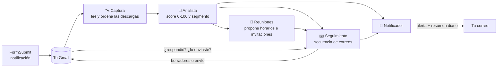
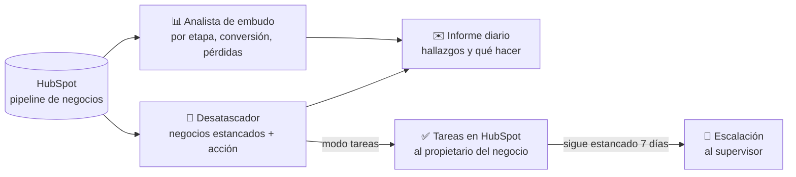
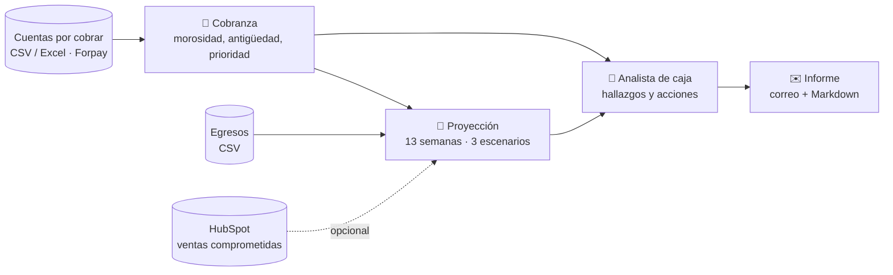

# Copahue · herramientas de finanzas

| App | Para qué sirve | Cómo se ejecuta |
|---|---|---|
| `tablero_ebook.py` | **Tablero con agentes** que analizan las descargas del ebook, te avisan por correo, hacen seguimiento y generan reuniones con potenciales clientes | `streamlit run tablero_ebook.py` |
| `run_agentes_hubspot.py` | **Agentes del embudo de HubSpot**: diagnostican dónde se atascan los negocios del pipeline y proponen (o crean) la acción para destrabarlos | `python run_agentes_hubspot.py --demo` |
| `run_agente_caja.py` | **Agente de caja** para la gerencia de finanzas: proyección semanal de caja, morosidad, cobranza prioritaria y alertas de liquidez a partir de tus cuentas por cobrar y egresos | `python run_agente_caja.py --demo` |
| `app.py` | Generador de reportes Forpay (cuotas por empresa a Excel) | `streamlit run app.py` |
| `grok.py` | Chat con tus documentos PDF (Groq + Gemini) | `streamlit run grok.py` |

---

## 📘 Tablero de agentes del ebook

Cada vez que alguien descarga el ebook desde tu sitio, FormSubmit te envía a Gmail un correo
**«Nueva descarga del ebook — Hyperion»** con nombre, correo, teléfono, cargo, empresa y motivo de descarga.
Los agentes leen esos correos y hacen el trabajo comercial por ti:



| Agente | Qué hace |
|---|---|
| **Captura** | Lee en Gmail las notificaciones de FormSubmit (o un CSV/Excel), evita duplicados y detecta descargas repetidas. |
| **Analista** | Puntúa cada lead (correo corporativo, cargo, empresa, motivo, país, teléfono, descargas repetidas, si respondió) y lo clasifica en 🔥 Caliente, 🌤️ Tibio o ❄️ Frío. Escribe una lectura comercial y cómo abordarlo. Resume tendencias. |
| **Seguimiento** | Arma una secuencia de 4 correos según el segmento (bienvenida → contenido de valor → invitación → último contacto). Los deja como **borradores en tu Gmail**, los envía solo o espera tu aprobación. Se detiene apenas el lead responde. |
| **Reuniones** | A los calientes y a quienes respondieron les propone 3 horarios hábiles. Genera el evento de Google Calendar con el lead como invitado, el archivo `.ics`, el link de WhatsApp y exporta los contactos a tu CRM (CSV compatible con HubSpot). |
| **Notificador** | Te envía una **alerta inmediata** cuando aparece un lead caliente o alguien te responde (con botones para responder, escribir por WhatsApp o agendar) y un **resumen diario** con las cifras del día. |

### Puesta en marcha (10 minutos)

```bash
pip install -r requirements.txt
cp .env.example .env          # completa GMAIL_USER y GMAIL_APP_PASSWORD
streamlit run tablero_ebook.py
```

1. **Contraseña de aplicación de Gmail**: activa la verificación en 2 pasos y crea una en
   <https://myaccount.google.com/apppasswords>. Pégala en `GMAIL_APP_PASSWORD`. (IMAP viene activo por defecto en Gmail.)
2. Abre el tablero y presiona **▶️ Ejecutar agentes ahora**: leerá las descargas de los últimos 120 días.
3. ¿Quieres verlo antes de conectar Gmail? En la barra lateral, **🧪 Datos de demostración → Cargar demo**
   (leads ficticios con dominios `.example`, que nunca reciben correos).

Personaliza en `.env` tu firma, el nombre del ebook, la oferta de reunión y, si tienes Calendly o
agenda de citas de Google, `LINK_AGENDA` (los correos usarán ese link en vez de proponer horarios).

### Modos de seguimiento

| Modo | Qué pasa con cada correo a un lead |
|---|---|
| `borradores` *(recomendado)* | Queda listo en **Borradores** de tu Gmail. Tú lo revisas y lo envías; el agente detecta que lo enviaste y sigue con el próximo paso. |
| `automatico` | Se envía solo, con un máximo de `SEGUIMIENTO_MAX_DIA` correos al día (primero los más calientes). |
| `manual` | Espera tu aprobación en la pestaña **✉️ Seguimiento** del tablero. |

Puedes cambiar el modo en la barra lateral del tablero. Los leads que descargaron hace más de 3 días y
nunca contactaste reciben un correo de **reactivación** (en vez de la bienvenida); los de más de 60 días quedan
para gestión manual, para no escribir en masa a una base antigua.

### Que trabajen solos las 24 horas

Elige una opción (no las dos con el mismo Gmail, para no duplicar borradores):

- **Tu PC o un servidor**: `python run_agentes.py --loop 15` revisa Gmail cada 15 minutos.
  El tablero (`streamlit run tablero_ebook.py`) lee la misma base de datos.
- **GitHub Actions** (gratis, sin PC encendido): el flujo `.github/workflows/agentes-ebook.yml` corre cada 30 minutos.
  En *Settings → Secrets and variables → Actions* crea los secrets `GMAIL_USER`, `GMAIL_APP_PASSWORD`
  (y opcionalmente `NOTIFY_EMAIL`, `ANTHROPIC_API_KEY`) y la variable `AGENTES_ACTIVOS=true`.
  Recibirás las alertas y el resumen por correo, y los borradores aparecerán en tu Gmail. En este modo
  el tablero es para consultar: usa allí el modo `manual` y gestiona los correos desde Gmail.

Comandos útiles:

```bash
python run_agentes.py              # un ciclo
python run_agentes.py --resumen    # fuerza el resumen diario
python run_agentes.py --sin-notificar
python run_agentes.py --demo       # carga datos ficticios
```

### IA opcional (Claude)

Con `ANTHROPIC_API_KEY`, el analista escribe una lectura más fina de los leads calientes y tibios, y
el agente de seguimiento personaliza cada correo (sin inventar datos y conservando horarios y links).
Usa el modelo `claude-opus-5-5` con esfuerzo bajo y respaldo automático del servidor (`fallbacks: "default"`)
si una solicitud es rechazada. Sin API key todo funciona igual con reglas y plantillas.

### ¿Cómo se calcula el score?

| Factor | Puntos |
|---|---|
| Correo corporativo (no Gmail/Hotmail/Outlook…) | +20 |
| Cargo: decisor (gerente, CFO, socio, fundador, dueño…) / jefatura / especialista / otro | +30 / +20 / +10 / +5 |
| Informó su empresa (independiente: +5) | +10 |
| Motivo: necesidad en su empresa / consultor-asesor / aprendizaje / otro | +25 / +10 / +3 / +5 |
| Dejó teléfono | +5 |
| País en `MERCADO_OBJETIVO` (por prefijo telefónico o dominio) | +10 |
| Descargó más de una vez | +10 |
| Respondió un correo | +25 |
| Descarga en los últimos 3 días | +5 |

🔥 Caliente ≥ `UMBRAL_CALIENTE` (70) · 🌤️ Tibio ≥ `UMBRAL_TIBIO` (40) · ❄️ Frío el resto.
Las reglas están en `agentes_ebook/analista.py` y las plantillas de correo en `agentes_ebook/plantillas.py`.

### Privacidad y seguridad

- Los datos de tus leads se guardan solo en `data/tablero_ebook.db` (ignorado por git) y, si usas Actions, en su caché privada.
- Las credenciales van en `.env` o en los Secrets de Streamlit/GitHub, nunca en el código.
- Los agentes leen Gmail en modo solo lectura (no marcan correos como leídos) y solo escriben borradores o
  envían correos según el modo que elijas.

### Pruebas

```bash
pip install pytest
pytest -q
```

Estructura:

```
agentes_ebook/
  config.py        configuración desde .env / secrets
  db.py            base SQLite: leads, descargas, seguimientos, reuniones, bitácora
  gmail.py         IMAP/SMTP: lee FormSubmit, detecta respuestas, crea borradores, envía
  captura.py       agente de captura (Gmail, CSV, demo)
  analista.py      agente analista (score, segmento, hallazgos)
  plantillas.py    correos, cadencias, links de WhatsApp y mailto
  seguimiento.py   agente de seguimiento
  reuniones.py     agente de reuniones (horarios, Google Calendar, .ics, CRM)
  notificador.py   alertas y resumen diario por correo
  llm.py           IA opcional con Claude
  orquestador.py   ciclo completo de los agentes
tablero_ebook.py   tablero Streamlit
run_agentes.py     ejecución por terminal / cron / GitHub Actions
agentes_hubspot/   agentes del embudo de HubSpot (sección siguiente)
  api.py           cliente de la API de HubSpot (pipelines, negocios, propietarios, tareas)
  embudo.py        Analista de embudo (etapas, conversión, pérdidas, hallazgos)
  desatascador.py  Desatascador (negocios estancados, acción propuesta, tareas, escalación)
  informe.py       informe en Markdown, HTML y texto
  demo.py          datos ficticios para probar sin HubSpot
run_agentes_hubspot.py  ejecución por terminal / cron / GitHub Actions
agentes_caja/      agente de caja (sección siguiente)
  fuentes.py       cuentas por cobrar (CSV/Excel o API de Forpay), egresos y ventas de HubSpot
  cobranza.py      morosidad por antigüedad, por sociedad y por compromiso; efectividad
  proyeccion.py    proyección semanal de caja en tres escenarios
  analista.py      hallazgos y acciones para finanzas
  informe.py       informe en Markdown, HTML y texto
run_agente_caja.py  ejecución por terminal / cron / GitHub Actions
```

---

## 📈 Agentes del embudo de HubSpot

Leen tu pipeline de negocios en HubSpot y te dicen **dónde se está atascando el embudo y qué hacer con cada negocio**.
Nacen de un diagnóstico real: en un pipeline de 1.400 negocios abiertos, un tercio estaba en «Sin Contacto» sin
próxima actividad, cientos llevaban semanas sin que nadie decidiera si seguir o cerrar, y decenas de negocios
ya pagados seguían «abiertos» distorsionando las cifras.



| Agente | Qué hace |
|---|---|
| **Analista de embudo** | Cuenta negocios abiertos por etapa, mediana de días en la etapa, cuántos no tienen próxima actividad y cuántos llevan ≥14 días sin contacto. Mide la conversión entre etapas de los negocios creados en los últimos 30 días, las razones de pérdida y la carga por propietario. Compara con la foto de la semana anterior y redacta **hallazgos y las 3 acciones de la semana**. |
| **Desatascador** | Marca como estancado todo negocio que supera los días típicos de su etapa **y** no tiene nada agendado a futuro. Según la parte del embudo propone la acción: *llamar hoy* (primer contacto), *reactivar o cerrar* (prospección), *confirmar qué pasó con la visita*, *acordar próximo paso con el cliente* (negociación) o *cerrar ganado / destrabar el cierre legal* (administrativo). En modo `tareas` crea la tarea en HubSpot al propietario del negocio, no insiste antes de 7 días y, si sigue estancado, escala al supervisor. |

### Puesta en marcha

```bash
pip install -r requirements.txt
python run_agentes_hubspot.py --demo --imprimir   # informe con datos ficticios, sin tocar HubSpot
```

1. Crea una **app privada** en HubSpot (Configuración → Integraciones → Aplicaciones privadas) con los permisos
   `crm.objects.deals.read`, `crm.objects.owners.read` y `crm.schemas.deals.read`. Copia el token en `HUBSPOT_TOKEN` del `.env`.
2. Indica el pipeline en `HUBSPOT_PIPELINE` (su id, por ejemplo `default`, o su nombre tal como aparece en HubSpot).
3. Ejecuta `python run_agentes_hubspot.py`. Recibirás el informe en tu correo (usa el mismo Gmail de los agentes del ebook)
   y quedará guardado en `data/informes/`. Mientras `HUBSPOT_MODO=lectura`, **no se modifica nada en HubSpot**.
4. Cuando el informe te convenza, pasa a `HUBSPOT_MODO=tareas` (agrega a la app privada el permiso para crear tareas) y,
   si quieres escalaciones, pon el id del supervisor en `HUBSPOT_SUPERVISOR_ID`.

Los umbrales de «estancado» se ajustan en el `.env` (`DESATASCAR_DIAS_*`, o por etapa con
`DESATASCAR_DIAS_POR_ETAPA="Sin Contacto=2,Promesa Firmada=30"`). Con `ANTHROPIC_API_KEY` el informe incluye además una
lectura ejecutiva redactada por Claude; sin ella, los hallazgos salen igual, calculados por reglas.

### Que trabajen solos

- **Tu PC o un servidor**: programa `python run_agentes_hubspot.py` en cron, una vez al día.
- **GitHub Actions**: el flujo `.github/workflows/agentes-hubspot.yml` corre de lunes a viernes a las 8:30 (Chile).
  Crea los secrets `HUBSPOT_TOKEN`, `GMAIL_USER`, `GMAIL_APP_PASSWORD` (y opcionalmente `NOTIFY_EMAIL`, `ANTHROPIC_API_KEY`),
  la variable `AGENTES_HUBSPOT_ACTIVOS=true` y, si quieres, `HUBSPOT_PIPELINE`, `HUBSPOT_MODO` y `HUBSPOT_SUPERVISOR_ID`.
  Cada ejecución deja el informe como artefacto del flujo y la memoria de los agentes (fotos y tareas creadas) en la caché.

---

## 💵 Agente de caja

Para la gerencia de finanzas: te dice **cuánto vas a cobrar y pagar cada semana, dónde se perfora la caja y a quién cobrar primero**.
No depende de ningún sistema en particular: lee tus cuentas por cobrar desde un CSV o Excel (planilla, contabilidad o banco),
tus egresos desde otro CSV y, si quieres, suma las ventas comprometidas de HubSpot.



| Qué entrega | Detalle |
|---|---|
| **Proyección semanal** | Cobros programados, cobros esperados (según tu tasa histórica de cobro), recuperación de mora, egresos, neto y saldo por semana. Escenarios base, pesimista y optimista. **Alerta** con la semana en que el saldo cae bajo tu caja mínima y cuánto falta. |
| **Cobranza** | Morosidad total y por sociedad, por antigüedad (1-15, 16-45, 46-90, más de 90 días) y la **lista de cobranza prioritaria** por compromiso, con la acción recomendada para cada tramo. Efectividad mensual: cuánto de lo que vencía se cobró. |
| **Hallazgos y acciones** | Reglas sobre la caja, la cobertura de egresos, la concentración de la mora, la mora antigua, los vencimientos de los próximos 7 días y la comparación con la semana anterior. Con `ANTHROPIC_API_KEY`, una lectura ejecutiva redactada por Claude. |

### Puesta en marcha

```bash
pip install -r requirements.txt
python run_agente_caja.py --demo --imprimir   # informe con datos ficticios
python run_agente_caja.py --plantillas        # crea data/cobros.csv y data/egresos.csv con filas de ejemplo
```

1. Reemplaza las filas de `data/cobros.csv` por tus cuentas por cobrar (una fila por cuota o factura: sociedad, cliente, compromiso,
   monto, fecha de vencimiento, estado, fecha de pago). También puedes apuntar a un Excel con `COBROS_ARCHIVOS` o `--archivo`.
   El agente reconoce los nombres de columna habituales; si alguno no lo detecta, fíjalo en `COBROS_CAMPOS`.
2. Completa `data/egresos.csv` con los egresos programados y recurrentes (remuneraciones, impuestos, créditos, obras).
3. En el `.env` pon el saldo en bancos de hoy en `CAJA_SALDO_INICIAL` y el mínimo que no quieres perforar en `CAJA_MINIMA`.
4. Ejecuta `python run_agente_caja.py`. El informe llega a tu correo (mismo Gmail de los demás agentes) y queda en `data/informes/`.

Si todavía no tienes el archivo de cobros, `CAJA_INCLUIR_PIPELINE=true` proyecta con el pie de los negocios avanzados de HubSpot,
ponderado por la probabilidad de su etapa. Y si usas Forpay, `FORPAY_EMPRESAS` lee las cuotas directamente de su API.

### Que trabaje solo

- **Tu PC o un servidor**: programa `python run_agente_caja.py` en cron, una vez al día.
- **GitHub Actions**: el flujo `.github/workflows/agente-caja.yml` corre de lunes a viernes a las 8:00 (Chile). Crea los secrets
  `GMAIL_USER` y `GMAIL_APP_PASSWORD`, la variable `AGENTE_CAJA_ACTIVO=true`, y `COBROS_ARCHIVOS` / `EGRESOS_ARCHIVO` apuntando a
  los CSV que subas al repositorio (o usa HubSpot con `CAJA_INCLUIR_PIPELINE=true`).
