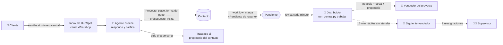

# 📞 Central de WhatsApp con Breeze (HubSpot)

Un solo número de WhatsApp para todos los avisos y campañas. El **agente Breeze** de HubSpot conversa
con cada cliente, responde con la información oficial de los proyectos y lo califica. Este paquete
(**distribuidor**) toma cada lead calificado y se lo entrega al **vendedor correcto del proyecto**, con
negocio, tarea y plazo de respuesta. Si el vendedor no responde a tiempo, el lead pasa al siguiente.



| Pieza | Dónde vive | Qué hace |
|---|---|---|
| Canal WhatsApp | Inbox de HubSpot (Meta) | Recibe y envía los mensajes del número central. |
| Agente Breeze | HubSpot (Customer Agent) | Conversa 24/7, responde con la base de conocimiento, califica y completa las propiedades del contacto. |
| Workflow | HubSpot | Cuando el agente califica a un contacto, marca la casilla «Pendiente de reparto (central)». Es una acción estándar: no necesita webhook ni Data Hub. |
| Distribuidor | Este repositorio (`central_whatsapp/`) | Cada minuto busca los contactos marcados, elige vendedor por proyecto y carga del día, crea el negocio y la tarea, respeta al vendedor si el cliente ya tenía uno, desmarca la casilla y reasigna o escala si nadie atiende. |

---

## 0. Requisitos

- **WhatsApp en el inbox de HubSpot.** HubSpot lo indica para Marketing Hub o Service Hub Professional/Enterprise.
  Revisa tu suscripción en *Configuración → Cuenta y facturación*.
- **Agente de clientes (Breeze Customer Agent)** con créditos de HubSpot. Confirma en tu portal que el agente
  puede desplegarse en el canal WhatsApp y cuántos créditos consume por conversación.
- Permisos de **Superadministrador** en HubSpot y de **administrador** en el Meta Business Manager de la empresa.
- **Un número dedicado** para la central, registrado en la app WhatsApp Business. No lo conectes también a
  otra integración (por ejemplo WhatHub): un número solo puede estar en una integración a la vez. WhatHub
  puede seguir sincronizando los WhatsApp personales de los vendedores.
- Un lugar donde corra el distribuidor como proceso permanente (Render, Railway, un VPS…, unos USD 7 al mes)
  o GitHub Actions (gratis, con algunos minutos más de demora).

## 1. Conectar el número central al inbox

1. HubSpot → *Configuración → Inbox y help desk → Inboxes* → **Conectar un canal → WhatsApp**.
2. Elige conectar con **coexistencia** (*coexistence*) si quieres seguir usando la app WhatsApp Business en un
   teléfono con el mismo número; HubSpot muestra un QR que escaneas desde la app.
   Sin coexistencia, los mensajes dejan de aparecer en la app del teléfono.
3. Asigna el canal a una bandeja (por ejemplo *Tu Proyecto de Vida Inbox_Equipo de Ventas*).

Guía oficial: [Conectar WhatsApp usando coexistencia](https://knowledge.hubspot.com/inbox/connect-a-whatsapp-number-to-hubspot-using-coexistence).

## 2. App privada y propiedades

1. HubSpot → *Configuración → Integraciones → Apps privadas* → **Crear app privada** «Central WhatsApp» con estos alcances:
   - `crm.objects.contacts.read` y `crm.objects.contacts.write`
   - `crm.objects.deals.read` y `crm.objects.deals.write`
   - `crm.objects.owners.read`
   - `crm.schemas.contacts.write` y `crm.schemas.deals.write` (solo para `instalar`)

   Si al crear tareas o notas HubSpot responde 403, el mensaje dice qué alcance falta: agrégalo a la app.
2. Copia el token en `.env` (`HUBSPOT_TOKEN`) junto con `HUBSPOT_PORTAL_ID` (el número de tu portal).
3. Crea las propiedades de la central (es idempotente, puedes repetirlo):

```bash
pip install -r requirements-central.txt
```

```bash
python run_central.py instalar
```

Crea el grupo **Central WhatsApp** con:

| Objeto | Propiedad | Para qué |
|---|---|---|
| Contacto | Plazo de compra · Forma de pago · Presupuesto · Quiere visitar el proyecto | Las completa Breeze al calificar. |
| Contacto | Pendiente de reparto (central) | La marca el workflow; el distribuidor la desmarca al asignar. |
| Contacto | Resumen de la conversación · Último ruteo | Resumen para el vendedor y fecha del último reparto. |
| Negocio | Estado en la central · Asignado por la central · Reasignaciones · Vendedores previos · Tarea de la central · Minutos hábiles hasta la atención | Seguimiento del SLA y reportes. |

Los rangos de **Presupuesto** están en `central_whatsapp/instalar.py`: ajústalos a tus precios antes de ejecutar.

## 3. Configurar el agente Breeze

Sigue [`breeze/instrucciones_agente.md`](breeze/instrucciones_agente.md): identidad, instrucciones para pegar,
calificación de leads (criterio → propiedad), traspaso a una persona y pruebas.
Para el contenido, usa [`breeze/base_conocimiento_plantilla.md`](breeze/base_conocimiento_plantilla.md)
(un artículo por proyecto + preguntas frecuentes).

## 4. Reglas de ruteo (`ruteo.yaml`)

El archivo dice qué vendedores atienden cada proyecto y con qué peso. Genéralo con tus datos reales:

```bash
python run_central.py sugerir-ruteo --dias 90 --supervisor ID_DEL_SUPERVISOR
```

Toma los negocios de los últimos 90 días por **Proyecto de Interés** y deja a los vendedores activos con al
menos 8% de participación, con peso proporcional. Revísalo con la gerencia comercial y luego:

```bash
python run_central.py validar
```

```bash
python run_central.py simular "Raíces de Curicó" --leads 20
```

`validar` avisa si hay vendedores inactivos o proyectos sin vendedores; `simular` muestra cómo se repartirían
20 leads sin tocar HubSpot. El formato completo está comentado en [`ruteo.ejemplo.yaml`](ruteo.ejemplo.yaml):
horario, feriados, SLA, supervisor, vacaciones (`ausente_desde`/`ausente_hasta`), tope diario (`max_diario`),
turnos propios y alias de proyectos.

> `ruteo.yaml` tiene nombres e IDs de tu equipo y **no se sube al repositorio** (está en `.gitignore`).
> En el servidor, pega su contenido en la variable `CENTRAL_RUTEO_YAML`.

### Cómo se elige al vendedor

1. **Aviso repetido**: si la central ya asignó o avisó por ese negocio hace menos de 30 minutos, no hace nada
   (por ejemplo, si el workflow vuelve a marcar al contacto).
2. **Cliente que vuelve**: si el contacto tiene un negocio abierto del mismo proyecto y su vendedor está activo, se
   queda con él: se le crea una tarea "Cliente volvió a escribir" y no se duplica el negocio.
3. **Lead nuevo**: entre los vendedores del proyecto que están activos en HubSpot, no ausentes y bajo su tope diario,
   prefiere a los que están en turno y elige al de **menor carga de hoy en ese proyecto en relación con su peso**
   (con pesos 4/3/2, de cada 9 leads reciben 4, 3 y 2).
4. **Sin vendedores**: proyecto sin vendedores → vendedores de su zona; sin proyecto → pool general; si nadie está
   disponible → supervisor.

Lo que crea en HubSpot:

- **Negocio** en *Pipeline de ventas → Identificación de Oportunidad* con nombre del cliente, Proyecto de Interés,
  Zona, Canal de contacto = Whatsapp y Fuente = `WhatsApp Central`, asociado al contacto.
- **Tarea** de prioridad alta para el vendedor, con vencimiento al cumplirse el SLA, la calificación, el resumen,
  el link `wa.me` del cliente y el link a su ficha.
- **Propietario del contacto** = vendedor asignado, salvo que ya tenga otro vendedor con negocios abiertos
  (`CENTRAL_PROPIETARIO_CONTACTO=si_libre`; también `siempre` o `nunca`). Así el traspaso de Breeze al
  "propietario del contacto" llega al vendedor correcto.

### SLA: nadie se queda sin respuesta

Un lead está **atendido** cuando el vendedor completa la tarea, mueve el negocio de *Identificación de Oportunidad*
o lo cierra. Si pasan `sla.minutos` (15) **hábiles** sin eso, el negocio y su tarea pasan al siguiente vendedor del
proyecto (con nota en el historial). Después de `max_reasignaciones` (2), se escala al supervisor con una tarea.
Al atenderse se guarda **Minutos hábiles hasta la atención** para medir tiempos de respuesta por vendedor.

## 5. Workflow en HubSpot (sin webhook)

*Automatización → Workflows → Crear → Basado en contactos*:

1. **Disparador**: *Estado del lead del agente de clientes* (Customer agent lead status) es **Calificado** o
   **Parcialmente calificado**. Activa la **reinscripción** cuando la propiedad cambie, para que un cliente que vuelve
   a calificar (por ejemplo, por otro proyecto) se reparta de nuevo.
   Si tu portal no muestra esa propiedad, usa *Plazo de compra es conocido* o *Quiere visitar el proyecto es conocido*.
2. **Acción**: *Editar registro* → **Pendiente de reparto (central)** = **Sí**.
3. Activa el workflow.

Eso es todo lo que hace HubSpot. El distribuidor busca cada minuto los contactos con esa casilla marcada, reparte
cada lead y la desmarca. Si HubSpot falla en ese momento, la casilla queda marcada y se reintenta en la siguiente
vuelta; si no hay ningún vendedor disponible, también queda marcada hasta que haya alguien.

## 6. Dejar corriendo el distribuidor

Es un proceso permanente: `python run_central.py trabajar` reparte los pendientes cada 60 segundos y revisa el SLA
cada 5 minutos. No necesita URL pública ni base de datos.

**Opción A · Render** (*New → Background Worker* desde este repositorio, plan Starter, unos USD 7 al mes):

| Campo | Valor |
|---|---|
| Build command | `pip install -r requirements-central.txt` |
| Start command | `python run_central.py trabajar` |
| Instancias | **1** |

Variables de entorno:

| Variable | Valor |
|---|---|
| `HUBSPOT_TOKEN` | token de la app privada |
| `HUBSPOT_PORTAL_ID` | ID del portal |
| `CENTRAL_RUTEO_YAML` | contenido completo de `ruteo.yaml` |
| `CENTRAL_SIMULAR` | `true` la primera semana si quieres ver qué haría sin escribir en HubSpot |
| `CENTRAL_CONSULTA_CADA_SEG` | opcional, por defecto `60` |

**Opción B · GitHub Actions** (gratis): el flujo `.github/workflows/central-ciclo.yml` corre `consultar` y `sla` cada
5 minutos. GitHub suele atrasar estas ejecuciones varios minutos, así que el vendedor puede recibir el lead entre 5 y
15 minutos después de la calificación. Sirve para empezar; para atención rápida usa la opción A.
Activa una sola de las dos opciones.

### Alternativa: webhook

Si algún día tienen **Data Hub Professional** (unos USD 720 al mes), el workflow puede usar *Enviar un webhook* en vez
de marcar la casilla, y el distribuidor recibe el aviso al instante con `python run_central.py servir` (servicio web,
`POST /webhooks/hubspot/lead` con el header `X-Central-Token` = `CENTRAL_WEBHOOK_SECRET`). Con un SLA de 15 minutos,
la consulta cada minuto da el mismo resultado sin ese costo.

## 7. Prueba de punta a punta

1. `python run_central.py asignar ID_DE_UN_CONTACTO --simular` → muestra a quién iría y qué escribiría, sin tocar nada.
2. Deja corriendo `trabajar` con `CENTRAL_SIMULAR=true`, escribe al número central desde un celular y completa la
   conversación. En menos de un minuto debería aparecer en los logs `1 pendientes · 1 asignados`.
3. Revisa los logs (solo cifras e IDs) y, cuando el resultado sea el esperado, cambia a `CENTRAL_SIMULAR=false`.
4. Repite: confirma el negocio, la tarea, el propietario y que el traspaso de la conversación llega al vendedor.
5. Deja pasar 15 minutos hábiles sin completar la tarea y verifica la reasignación.

## 8. Reportes sugeridos

Con las propiedades de la central puedes armar un dashboard en HubSpot:

- Negocios con Fuente = `WhatsApp Central` por **Proyecto de Interés** y por **propietario** (semana / mes).
- Promedio de **Minutos hábiles hasta la atención** por vendedor.
- Negocios con **Estado en la central** = *Reasignado* o *Escalado* (vendedores que no alcanzan a responder).
- Conversión: negocios de la central que llegan a *Visita Agendada* y *Parcela Reservada*.

## Alternativa sin servidor

Se puede repartir solo con HubSpot: un workflow con una rama por proyecto y la acción **Rotar registro a
propietario** en cada rama. Sirve para empezar, pero con muchos proyectos hay que mantener cada rama a mano y no
considera carga del día, pesos, vacaciones, clientes que vuelven ni reasignación por SLA. El distribuidor hace todo
eso con un solo archivo.

## Seguridad y privacidad

- El distribuidor no expone nada a internet en el modo recomendado (`trabajar`): solo consulta a HubSpot.
- En el modo webhook, el servicio exige `CENTRAL_WEBHOOK_SECRET`; sin él no procesa nada.
- Los logs y la salida del SLA solo muestran IDs y cifras, nunca nombres ni teléfonos (importante si usas GitHub
  Actions en un repositorio público).
- No hay base de datos propia: todo el estado vive en HubSpot (propiedades `central_*`).
- El token de HubSpot y el ruteo van en variables de entorno o secretos, nunca en el código.

## Comandos

```bash
python run_central.py instalar                     # propiedades en HubSpot
python run_central.py sugerir-ruteo --sobrescribir # regenerar ruteo.yaml con los últimos 90 días
python run_central.py validar                      # revisar el ruteo
python run_central.py simular "Fundo Las Ortigas"  # reparto de prueba, sin HubSpot
python run_central.py asignar 123456 --simular     # rutear un contacto real sin escribir
python run_central.py trabajar                     # reparto cada minuto + SLA (recomendado)
python run_central.py trabajar --una-vez           # una vuelta y salir, para probar
python run_central.py consultar                    # una vuelta de reparto (cron / GitHub Actions)
python run_central.py sla --loop 5                 # solo el SLA
python run_central.py servir --puerto 8000         # modo webhook (requiere Data Hub Professional)
pytest tests/test_central.py -q                    # pruebas
```

Estructura:

```
central_whatsapp/
  config.py        configuración técnica desde el entorno
  hubspot.py       cliente de la API de HubSpot (reintentos, modo solo lectura)
  ruteo.py         reglas: proyectos, pesos, horarios, ausencias, minutos hábiles
  distribuidor.py  asigna cada lead: negocio, tarea, propietario
  consulta.py      reparto periódico de los contactos marcados como pendientes
  sla.py           reasigna o escala los leads no atendidos
  servicio.py      modo webhook (FastAPI): /webhooks/hubspot/lead, /tareas/sla, /salud
  instalar.py      propiedades de la central en HubSpot
  sugerir.py       genera ruteo.yaml desde los negocios de HubSpot
  notificar.py     aviso opcional por correo
  breeze/          textos para configurar el agente y la base de conocimiento
run_central.py     comandos
```
